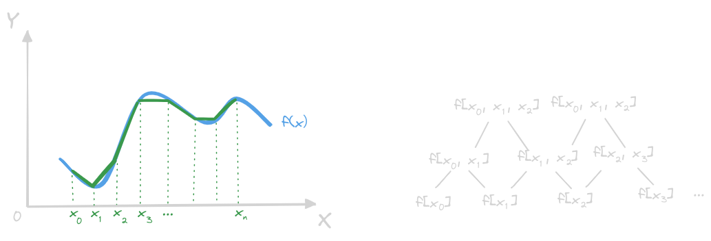

# 函数插值
---
利用差值法构造未知函数或复杂函数的**近似函数**

## 插值问题与插值多项式

### 插值问题
- 定义**实值函数** $f(x)$ 在区间 $[a,b]$ 上，在 $n+1$ 个互异节点 $\{x_{i}\}_{i=0}^{n}$ 上的函数值为 $\{f(x_{i})\}_{i=0}^{n}$，定义函数集合 $\Phi$，令某一个 $\varphi(x)\in\Phi$，满足：
    $$\varphi(x_{i}) = f(x_{i})\qquad(\forall i=,0,1,\cdots,n)$$
    - $\varphi(x)$ 为 $f(x)$ 关于节点 $\{x_{i}\}_{i=0}^{n}$ 的一个**插值函数**
    - $f(x)$ 为**被插值函数**
    - $[a,b]$ 为**插值区间**，$\{x_{i}\}_{i=0}^{n}$ 为**插值节点**
    - 这类问题叫做 **Lagrange 型的插值问题**
- 令：
    $$M=\max_{0\leq i\leq n}x_{i},\qquad, m=\min_{0\leq i\leq n}x_{i}$$
    - 内插法：$x\in[m,M]$ 时用插值函数 $\varphi(x)$ 近似 $f(x)$ 的方法
    - 外插法：$x\in[a,b]\wedge x\notin[m,M]$ 时用插值函数 $\varphi(x)$ 近似 $f(x)$ 的方法
- 其他插值类型：
    - 三角插值：函数集合 $\Phi$ 由**三角函数的线性组合**组成
    - 有理插值：函数集合 $\Phi$ 由一类**有理分式**组成
    - 多项式插值（代数插值）：函数集合 $\Phi$ 是**不超过 $n$ 次的多项式集合**

### 插值多项式
- 取插值函数集合 $\Phi$ 为不超过 $n$ 次的**多项式空间**：
    $$
    \Phi = \left\{\varphi(x)\,\,\Big\vert\,\,\varphi(x)=\sum_{i=0}^{n}a_{i}x^{i},\,\,a_{i}\in\mathbb R\right\}
    $$
    问题在于**确定系数** $\{x_{i}\}_{i=0}^{n}$ 的值，也即求解 **Vandermonde 矩阵**作为系数矩阵的对应的线性方程组：
    $$
    \begin{bmatrix}
    1 & x_{0} & x_{0}^{2} & \cdots & x_{0}^{n}\\
    1 & x_{1} & x_{1}^{2} & \cdots & x_{1}^{n}\\
    \vdots & \vdots & \vdots & \ddots & \vdots\\
    1 & x_{n} & x_{n}^{2} & \cdots & x_{n}^{n}\\
    \end{bmatrix}
    \begin{bmatrix}
    a_{0} \\ a_{1} \\ \vdots \\ a_{n}
    \end{bmatrix}
    =
    \begin{bmatrix}
    f(x_{0}) \\ f(x_{1}) \\ \vdots \\ f(x_{n})
    \end{bmatrix}
    $$
    由于 $x_{i}$ 彼此互异，故 Vandermonde 矩阵非奇异，线性方程组**有唯一解**
- 假设 $f^{(n)}(x)$ 在区间 $[a,b]$ 上连续，$f^{(n+1)}(x)$ 在 $[a,b]$ 内存在（有且仅能有第二类间断点的存在，见[罗尔定理](./补充/罗尔定理和函数插值法.md)，对于插值多项式 $\varphi(x)$ 而言，
    $$
    \forall x\in[a,b],\exists \xi=\xi(x)\in(a,b)
    $$
    使得：
    $$
    R_{n}(x) = f(x)-\varphi(x) =
    \frac{f^{(n+1)}(\xi)}{(n+1)!}\prod_{i=0}^{n}(x-x_{i})
    $$
    若 $\lvert f^{(n+1)}(\xi)\rvert$ 有**上界** $M_{n+1}$ 的时候，可以使得插值误差成立：
    $$
    \lvert R_{n}(x)\rvert\leq\frac{M_{n+1}}{(n+1)!}\left\lvert\prod_{i=0}^{n}(x-x_{i})\right\rvert
    $$
    这就说明在 $x$ 点处的插值误差和**插值节点 $\{x_{i}\}_{i=0}^{n}$ 与该点的距离有关**
- 当被插值函数是不超过 $n$ 次的多项式的时候，满足插值条件
    $$f(x_{i}=\varphi(x_{i}),\qquad(i=0,1,2,\cdots,n)$$
    且不超过 $n$ 次的插值多项式和被插值多项式恒等

## Lagrange 插值

### Lagrange 插值基函数
- 针对 $n+1$ 个互异的插值节点 $\{x_{i}\}_{i=0}^{n}$，试构造不超过 $n$ 次的插值多项式 $l_{i}(x)$，满足：
    $$
    l_{i}(x_{j}) = \delta_{ij} = 
    \begin{cases} 
    1,\qquad(i=j)\\
    0,\qquad(i\neq j)\\
    \end{cases}
    $$
    其中 $i=0,1,2,\cdots,n$
- 这意味着 $l_{i}(x)$ 除了 $x_{i}$ 时为 $1$，则其他的插值点的函数值都是 $0$，可以写成：
    $$
    \begin{align*}
    l_{i}(x) &= c_{i}\prod_{j\neq i,j=0}^{n}(x-x_{j})\\
    l_{i}(x_{i}) &= c_{i}\prod_{j\neq i,j=0}^{n}(x_{i}-x_{j}) = 1
    \end{align*}
    $$
    可以解出：
    $$
    c_{i} = \frac{1}{\displaystyle\prod_{j\neq i,j=0}^{n}(x_{i}-x_{j})}
    $$
- 因此就得到了一个 $n$ 次插值多项式：
    $$
    l_{i}(x) = 
    \frac
    {\displaystyle\prod_{j\neq i,j=0}^{n}(x-x_{j})}
    {\displaystyle\prod_{j\neq i,j=0}^{n}(x_{i}-x_{j})}
    $$
    当 $i=0,1,2,\cdots,n$ 的时候，这 $n+1$ 个 $n$ 次插值多项式 $l_{0}(x), l_{1}(x), l_{2}(x), \cdots, l_{n}(x)$ 就被称为关于节点 $\{x_{i}\}_{i=0}^{n}$ 的 **Lagrange 插值基函数**，这一组基函数**仅依赖于插值节点 $\{x_{i}\}_{i=0}^{n}$，而与被插值函数无关**
    
### Lagrange 插值公式
- 针对 $\varphi(x)$ 这个由线性方程组求解出来的插值多项式，具有这样的性质：
    $$
    \varphi(x_{i}) = f(x_{i})\qquad (i=0,1,2,\cdots,n)
    $$
- 展开成线性方程组的形式：
    $$
    \begin{bmatrix}
    \varphi(x_{0})\\
    \varphi(x_{1})\\
    \vdots\\
    \varphi(x_{n})
    \end{bmatrix}
    =
    \begin{bmatrix}
    1 & x_{0} & x_{0}^{2} & \cdots & x_{0}^{n}\\
    1 & x_{1} & x_{1}^{2} & \cdots & x_{1}^{n}\\
    \vdots & \vdots & \vdots & \ddots & \vdots\\
    1 & x_{n} & x_{n}^{2} & \cdots & x_{n}^{n}\\
    \end{bmatrix}
    \begin{bmatrix}
    a_{0} \\ a_{1} \\ \vdots \\ a_{n}
    \end{bmatrix}
    =
    \begin{bmatrix}
    f(x_{0})\\
    f(x_{1})\\
    \vdots\\
    f(x_{n})
    \end{bmatrix}
    $$
    简写成：
    $$\bm\varphi = \bm V\bm a=\bm f$$
- 由于节点互异，$\bm V$ 的**列向量组无法化约，彼此线性无关**，因此 $\bm V$ 可逆满秩，因此：
    $$\bm a = \bm V^{-1}\bm f$$
    因此插值多项式可以写成：
    $$
    \varphi(x) 
    = (\bm V^{-1}\bm f)^{\mathrm T}\bm x
    = \sum_{p=0}^{n}(\bm V^{-1}\bm f)_{p}x^{p}
    = \sum_{p=0}^{n}\left(\sum_{q=0}^{n}(\bm V^{-1})_{pq}f(x_{q})\right)x^{p}
    $$
    展开成矩阵：
    $$
    \begin{bmatrix}
    (\bm V^{-1}\bm f)_{0} & (\bm V^{-1}\bm f)_{1} & \cdots & (\bm V^{-1}\bm f)_{n}
    \end{bmatrix}
    \begin{bmatrix}
    1 \\ x \\ \vdots \\ x^{n}
    \end{bmatrix}
    =
    \begin{bmatrix}
    f(x_{0}) & f(x_{1}) & \cdots & f(x_{n})
    \end{bmatrix}
    (\bm V^{-1})^{\mathrm T}
    \begin{bmatrix}
    1 \\ x \\ \vdots \\ x^{n}
    \end{bmatrix}
    $$
    因此：
    $$
    \varphi(x) 
    =
    \sum_{q=0}^{n}\left(f(x_{q})\sum_{p=0}^{n}(\bm V^{-1})_{pq}x^{p}\right)
    =
    \sum_{q=0}^{n}f(x_{q})l_{q}(x)
    $$
    其中
    $$l_{q}(x) = \sum_{p=0}^{n}(\bm V^{-1})_{pq}x^{p}$$
    利用插值多项式，将这个式子**显化**：
    $$
    \varphi(x_{q}) =
    \sum_{q=0}^{n}f(x_{q})l_{q}(x_{q}) = 
    \sum_{q=0}^{n}f(x_{q})\delta_{qr}
    =f(x_{q})
    \qquad
    (q=0,1,\cdots, n)
    $$
    也即时说：
    $$
    l_{q}(x_{r}) = \delta_{qr}
    =
    \begin{cases}
    1\qquad(q=r)\\
    0\qquad(q\neq r)\\
    \end{cases}
    $$
    也即时说，**多项式 $l_{q}(x)$ 有 $x_{0},x_{1},\cdots,x_{q-1},x_{q+1},\cdots,x_{n}$ 一共 $n$ 个根**，并且 $l_{q}(x_{q}) = 1$，这正是 Lagrange 插值基函数满足的条件，**两者等价**！
- 由此，可以构造 **Lagrange 插值多项式**：
    $$
    \varphi(x) = L_{n}(x) = \sum_{i=0}^{n}f(x_{i})l_{i}(x) = 
    \sum_{i=0}^{n}f(x_{i})
    \frac
    {\displaystyle\prod_{j\neq i,j=0}^{n}(x-x_{j})}
    {\displaystyle\prod_{j\neq i,j=0}^{n}(x_{i}-x_{j})}
    $$
    插值余项和误差估计类似，并且注意到，若
    $$f(x_{0}) = f(x_{1}) = \cdots = f(x_{n}) = 1$$
    则根据 Vandermonde 矩阵的线性无关性，其必然满足
    $$a_{0} = 1, a_{1} = a_{2} = \cdots = a_{n} = 0$$
    因此：
    $$\sum_{i=0}^{n}l_{i}(x) \equiv 1$$
    注意，**Lagrange 插值基函数和被插值函数无关**，因此这是一个**恒等式**

## Newton 插值
    
### 差商及其性质
- 设 $\{x_{i}\}_{i=0}^{n}$ 为**互异节点**

- 各阶差商的意义：
    - 零阶差商为函数值：
        $$f[x_{i}] = f(x_{i})$$
    - 一阶差商为折线斜率（对标导数）：
        $$f[x_{i},x_{j}] = \frac{f(x_{i})-f(x_{j})}{x_{i}-x_{j}}$$
    - 二阶差商为折线斜率的斜率（对标二阶导数）：
        $$
        f[x_{i},x_{j},x_{k}] = 
        \frac{f[x_{i},x_{j}]-f[x_{j},x_{k}]}{(x_{i}-x_{k})} = 
        \frac{f(x_{i})}{(x_{i}-x_{k})(x_{i}-x_{j})} + \frac{f(x_{j})}{(x_{j}-x_{i})(x_{j}-x_{k})} +
        \frac{f(x_{k})}{(x_{k}-x_{i})(x_{k}-x_{j})}
        $$
   - 以此类推可以得到 $k$ 阶差商：
        $$
        f[x_{0},x_{1},\cdots,x_{k}] 
        = \frac{f[x_{0},x_{1},\cdots,x_{k-1}]-f[x_{1},x_{2},\cdots,x_{k}]}{(x_{0}-x_{k})}
        = \sum_{i=0}^{k}\frac{f(x_{i})}{\displaystyle\prod_{j\neq i,j=0}^{k}(x_{i}-x_{j})}
        $$
- 差商的对称性：
    $$
    f[x_{0},x_{1},\cdots,x_{k}]  = 
    f[x_{i_{0}},x_{i_{1}},\cdots,x_{i_{k}}]
    $$
    其中 $i_{0},i_{1},\cdots,i_{k}$ 是 $0,1,\cdots,k$ 的**任意排列**
- 计算差商，可以利用差商表（各阶差商用**上阶差商的差除以最末减最初节点距离**得到）：
    $$
    \begin{array}{|c|c|c|c|c|}
    \hline
    \\
    x_{i} & f[x_{i}] & \text{1st-order} & \text{2nd-order} & \text{3rd-order} \\
    \\
    \hline
    \\
    x_{0} & f[x_{0}] &  &  &  \\
    \\
    \\
    x_{1} & f[x_{1}] & f[x_{0},x_{1}] &  &  \\
    \\
    \\
    x_{2} & f[x_{2}] & f[x_{1},x_{2}] & f[x_{0},x_{1},x_{2}] &  \\
    \\
    \\
    x_{3} & f[x_{3}] & f[x_{2},x_{3}] & f[x_{1},x_{2},x_{3}] & f[x_{0},x_{1},x_{2},x_{3}] \\
    \\
    \hline
    \end{array}
    $$
### Newton 插值公式
- 利用差商的定义，本阶差商要上一阶差商的差商来求，则换言之，将 $x$ 视为 $x_{-1}$，可以写出：
    $$
    \begin{align*}
    f[x] &= f[x_{0}] + f[x,x_{0}](x-x_{0})\\
    f[x,x_{0}] &= f[x_{0},x_{1}] + f[x,x_{0},x_{1}](x-x_{1})\\
    f[x,x_{0},x_{1}] &= f[x_{0},x_{1},x_{2}] + f[x,x_{0},x_{1},x_{2}](x-x_{2})\\
    &\vdots \\
    f[x,x_{0},x_{1},\cdots,x_{n-2}] &= f[x_{0},x_{1}\cdots,x_{n-1}] + f[x,x_{0},x_{1},\cdots,x_{n-1}](x-x_{n-1})\\
    f[x,x_{0},x_{1},\cdots,x_{n-1}] &= f[x_{0},x_{1},\cdots,x_{n}] + f[x,x_{0},x_{1},\cdots,x_{n}](x-x_{n})\\
    \end{align*}
    $$
- 将上述方程组不断回代，可以得到：
    $$
    \begin{align*}
    f(x) =& f[x_{0}] + f[x_{0},x_{1}](x-x_{0}) + f[x_{0},x_{1},x_{2}](x-x_{0})(x-x_{1}) + 
    \cdots +\\
        &f[x_{0},x_{1},\cdots,x_{n}]\prod_{j=0}^{n-1}(x-x_{j}) + 
        f[x,x_{0},x_{1},\cdots,x_{n}]\prod_{j=0}^{n}(x-x_{j})
    \end{align*}
    $$
    也即：
    $$
    f(x) = f[x_{0}] +
    \sum_{i=1}^{n}\left(f[x_{0},x_{1},\cdots,x_{i}]\left(\prod_{j=0}^{i-1}(x-x_{j})\right)\right) + 
    f[x,x_{0},x_{1},\cdots,x_{n}]\prod_{j=0}^{n}(x-x_{j})
    $$
    定义多项式函数：
    $$
    N_{n}(x) = f[x_{0}] + \sum_{i=1}^{n}\left(f[x_{0},x_{1},\cdots,x_{i}]\left(\prod_{j=0}^{i-1}(x-x_{j})\right)\right)
    $$
    则被插值函数又可以写成：
    $$
    f(x) = N_{n}(x) + 
    f[x,x_{0},x_{1},\cdots,x_{n}]\prod_{j=0}^{n}(x-x_{j})
    $$
- 上述多项式函数 $N_{n}(x)$ 满足插值条件：
    $$f(x_{k}) = N_{n}(x_{k})$$
    因此，称 $N_{n}(x)$ 为 $f(x)$ 关于节点 $\{x_{k}\}_{k=0}^{n}$ 的 **Newton 插值多项式**，这种表示形式有利于节点的增减：
    $$
    N_{n+1}(x) = N_{n}(x) + 
    f[x_{0},x_{1},\cdots,x_{n+1}]\prod_{j=0}^{n}(x-x_{j})
    $$
- 这里的插值基函数组为：
    $$\omega_{i+1}(x) = \prod_{j=0}^{i}(x-x_{j})$$
    被称为关于节点 $\{x_{k}\}_{k=0}^{n}$ 的 **Newton 插值基函数组**，线性组合系数为各阶差商列的第一行
- Newton 插值多项式的插值余项（差商型插值余项）：
    $$
    R_{n}(x) = 
    f[x,x_{0},x_{1},\cdots,x_{n}]\prod_{j=0}^{n}(x-x_{j})
    $$
    利用构造函数和罗尔定理，外加上插值多项式的唯一性，一定有（导数型插值余项）：
    $$
    \exists\xi\in(m,M),\,\,\, 
    f[x,x_{0},x_{1},\cdots,x_{n}]\prod_{j=0}^{n}(x-x_{j})
    =
    \frac
    {f^{(n+1)}(\xi)}{(n+1)!}\prod_{j=0}^{n}(x-x_{j})
    $$
    注意，同一个插值函数的插值余项**只有一个**，因此比较可得到：
    $$
    f[x,x_{0},x_{1},\cdots,x_{n}] = \frac{f^{(n+1)}(\xi)}{(n+1)!}
    $$
    应当注意，**导数型插值余项对被插值函数的光滑性要求较高**

## 等距节点插值
解决完了插值公式的表达，现在考虑对插值点的划分

### 差分算子及其性质
- 考虑将节点 $\{x_{i}\}_{i=0}^{n}$ **等距划分**：
    $$x_{i} = a+ih,\qquad(i=0,1,\cdots,n)$$
    也即 $x_{0} = a$，然后每个节点的距离都是**节点步长** $h$，记 $f(a+ih) = f_{i}$，设 $k$ 为任意整数
- 四种典型的算子：
    - 向前差分算子 $\Delta$：
        $$
        \begin{align*} 
        \Delta f_{i} &= f_{i+1}-f_{i}\\
        \Delta^{2}f_{i} &= \Delta(\Delta f_{i}) = (f_{i+2}-f_{i+1})-(f_{i+1}-f_{i}) = f_{i+2}-2f_{i+1}+f_{i}\\
        &\vdots\\
        \Delta^{k}f_{i} &= \Delta(\Delta^{k-1}f_{i}) = f_{i+k} - kf_{i+k-1} +\cdots + \binom{k}{p}(-1)^{k-p}f_{i+p} + \cdots (-1)^{k-1}kf_{i+1} + (-1)^{k}f_{i}
        \end{align*}
        $$
        也即可以写成
        $$
        \Delta^{k}f_{i} = \displaystyle\sum_{p=0}^{k}\binom{k}{p}(-1)^{k-p}f_{i+p} =
        \sum_{p=0}^{k}\frac{k!}{p!(k-p)!}(-1)^{k-p}f_{i+p}
        $$
    - 向后差分算子 $\nabla$：
        $$
        \begin{align*} 
        \nabla f_{i} &= f_{i}-f_{i-1}\\
        \nabla^{2}f_{i} &= \nabla(\nabla f_{i}) = (f_{i}-f_{i-1})-(f_{i-1}-f_{i-2}) = f_{i}-2f_{i-1}+f_{i-2}\\
        &\vdots\\
        \nabla^{k}f_{i} &= \nabla(\nabla^{k-1}f_{i}) = f_{i} - kf_{i-1} +\cdots + \binom{k}{p}(-1)^{k-p}f_{i-p} + \cdots (-1)^{k-1}kf_{i-k+1} + (-1)^{k}f_{i-k}
        \end{align*}
        $$
        也即可以写成
        $$
        \nabla^{k}f_{i} = \displaystyle\sum_{p=0}^{k}\binom{k}{p}(-1)^{p}f_{i-p} =
        \sum_{p=0}^{k}\frac{k!}{p!(k-p)!}(-1)^{p}f_{i-p}
        $$
    - 恒等算子 $I$：
        $$ 
        \begin{align*}
        If_{i} &= f_{i}\\
        I^{k}f_{i} &= I(I^{k-1}f_{i}) = f_{i}\\
        I^{s}f_{i} &= f_{i}\qquad s\in\mathbb R
        \end{align*}
        $$
        第三个式子将恒等算子推广到了**任意实数** $s\in\mathbb R$
    - 移位算子 $E$：
        $$ 
        \begin{align*}
        Ef_{i} &= f_{i+1}\\
        E^{k}f_{i} &= E(E^{k-1}f_{i}) = f_{i+k}\\
        E^{s}f_{i} &= f_{i+s}\qquad s\in\mathbb R
        \end{align*}
        $$
- 四种算子的关系：
    $$\Delta = E\nabla\qquad\nabla=E^{-1}\Delta\qquad\nabla^{k}=E^{-k}\Delta^{k}$$
- 对于等距节点，差商可以用差分关系写的很简洁：
    $$
    f[x_{0},x_{1},\cdots,x_{k}] 
    = \sum_{i=0}^{k}\frac{f(x_{i})}{\displaystyle\prod_{j\neq i,j=0}^{k}(x_{i}-x_{j})}
    = \sum_{i=0}^{k}\frac{f(x_{i})}{(-1)^{k-i}i!(k-i)!h^{k}} 
    = \sum_{i=0}^{k}\frac{k!}{i!(k-i)!}\frac{(-1)^{k-i}f(x_{i})}{k!h^{k}}
    $$
    也即：
    $$
    f[x_{0},x_{1},\cdots,x_{k}] 
    = \sum_{i=0}^{k}\binom{k}{i}\frac{(-1)^{k-i}f(x_{0}+ih)}{k!h^{k}}
    = \frac{\Delta^{k} f(x_{0})}{k!h^{k}}
    $$
    同理可以得到向后差分公式：
    $$
    f[x_{n},x_{n-1},\cdots,x_{n-k}] 
    = \sum_{i=0}^{k}\binom{k}{i}\frac{(-1)^{i}f(x_{n}-ih)}{k!h^{k}}
    = \frac{\nabla^{k} f(x_{n})}{k!h^{k}}
    $$
- 类似于差商表，也可以写出差分表，向前和向后

### 等距节点插值公式
- Newton 向前插值：
    - 前述可知 Newton 插值多项式为：
        $$
        N_{n}(x) = f[x_{0}] + \sum_{i=1}^{n}\left(f[x_{0},x_{1},\cdots,x_{i}]\left(\prod_{j=0}^{i-1}(x-x_{j})\right)\right)
        $$
        不妨设 $x=x_{0}+th$，则：
        $$
        N_{n}(x_{0}+th) = f[x_{0}] + \sum_{i=1}^{n}\left(f[x_{0},x_{1},\cdots,x_{i}]h^{i}\binom{t}{i}i!\right)
         $$
    - 代入差分公式：
        $$
        N_{n}(x_{0}+th) = 
        f[x_{0}] + \sum_{i=1}^{n}\left(\frac{\Delta^{i} f(x_{0})}{i!h^{i}}h^{i}\binom{t}{i}i!\right)
        = f[x_{0}] + \sum_{i=1}^{n}\binom{t}{i}\Delta^{i} f(x_{0})
        $$
        简写成：
        $$
        N_{n}(x_{0}+th) = 
        f_{0} + \sum_{i=1}^{n}\binom{t}{i}\Delta^{i} f_{0}
        $$
    - 注意 $t\in\mathbb R$，因此这推广了组合数，这样的 $N_{n}$ 被称为 **Newton 向前插值多项式**，插值余项为
        $$
        R_{n}(x_{0}+th) = 
        \frac
        {f^{(n+1)}(\xi)}{(n+1)!}\prod_{j=0}^{n}(x-x_{j})
        =
        \frac
        {f^{(n+1)}(\xi)}{(n+1)!}h^{n+1}t(t-1)\cdots(t-n)
        $$
        化简后得到：
        $$
        R_{n}(x_{0}+th) = 
        f^{(n+1)}(\xi)h^{n+1}\binom{t}{n+1}
        $$
        其中 
       $$\xi\in\left(\min(x,x_{0},x_{1},\cdots,x_{n}),\max(x,x_{0},x_{1},\cdots,x_{n})\right)$$
- Newton 向后插值：
    - 将插值节点从大到小排列：
        $$x_{n},x_{n-1} = x_{n}-h, \cdots, x_{0} = x_{n}-nh$$
        重写 Newton 插值公式可以得到：
        $$
        N_{n}(x) = f[x_{n}] +
        \sum_{i=1}^{n}\left(f[x_{n},x_{n-1},\cdots,x_{n-i}]\left(\prod_{j=0}^{i-1}(x-x_{n-j})\right)\right)
        $$
        令 $x=x_{n}+th$，则：
        $$
        N_{n}(x_{n}+th) = f[x_{n}] +
        \sum_{i=1}^{n}\left(f[x_{n},x_{n-1},\cdots,x_{n-i}]h^{i}\binom{t+i-1}{i}i!\right)
        $$
    - 代入向后差分公式可以得到
        $$
        N_{n}(x_{n}+th) = 
        f[x_{n}] +
        \sum_{i=1}^{n}\left(\frac{\nabla^{i} f(x_{n})}{i!h^{i}}h^{i}\binom{t+i-1}{i}i!\right)
        =
        f[x_{n}] +
        \sum_{i=1}^{n}\binom{t+i-1}{i}\nabla^{i} f(x_{n})
        $$
        简写成：
        $$
        N_{n}(x_{n}+th) = 
        f[x_{n}] +
        \sum_{i=1}^{n}\binom{t+i-1}{i}\nabla^{i} f_{n}
        $$
    - 这样的 $N_{n}$ 被称为 **Newton 向后插值多项式**，插值余项为
        $$
        R_{n}(x_{n}+th) = 
        \frac
        {f^{(n+1)}(\xi)}{(n+1)!}\prod_{j=0}^{n}(x-x_{j})
        =
        \frac
        {f^{(n+1)}(\xi)}{(n+1)!}h^{n+1}t(t+1)\cdots(t+n)
        $$
        化简后得到：
        $$
        R_{n}(x_{0}+th) = 
        f^{(n+1)}(\xi)h^{n+1}\binom{t+n}{n+1}
        $$
        其中 
        $$\xi\in\left(\min(x,x_{0},x_{1},\cdots,x_{n}),\max(x,x_{0},x_{1},\cdots,x_{n})\right)$$

## Hermite 插值
一种对 Lagrange 插值问题的推广，要求满足基本的插值条件，还要求在某些点有**相同的导数** 

### Hermite 插值多项式的构造
- 已知函数 $f(x)$ 在互异节点 $\{x_{i}\}_{i=0}^{n}$ 上的函数值，以及一阶导数值依次如下：
    $$
    \{f(x_{i})\}_{i=0}^{n}, \{f'(x_{i})\}_{i=0}^{n}
    $$
- 考虑构造一个**不超过 $2n+1$ 次的多项式** $H_{2n+1}$，满足**如下 $2n+2$ 个插值条件**：
    $$
    \begin{cases}
    H_{2n+1}(x_{i}) = f(x_{i})\\
    H_{2n+1}'(x_{i}) = f'(x_{i})\\
    \end{cases}\qquad (i=0,1,\cdots,n)
    $$
- 下面类似于构造 Lagrange 插值基函数，求解 Hermite 插值问题（有点像状态空间），考虑一个线性方程组：
    $$
    \begin{bmatrix}
    1 & x_{0} & x_{0}^{2} & \cdots & x_{0}^{n} & x_{0}^{n+1} & \cdots & x_{0}^{2n+1}\\
    1 & x_{1} & x_{1}^{2} & \cdots & x_{1}^{n} & x_{1}^{n+1} & \cdots & x_{1}^{2n+1}\\
    \vdots & \vdots & \vdots & & \vdots & \vdots & & \vdots\\
    1 & x_{n} & x_{n}^{2} & \cdots & x_{n}^{n} & x_{n}^{n+1} & \cdots & x_{n}^{2n+1}\\
    1 & x_{n+1} & x_{n+1}^{2} & \cdots & x_{n+1}^{n} & x_{n+1}^{n+1} & \cdots & x_{n+1}^{2n+1}\\
    \vdots & \vdots & \vdots & & \vdots & \vdots & & \vdots\\
    1 & x_{2n+1} & x_{2n+1}^{2} & \cdots & x_{2n+1}^{n} & x_{2n+1}^{n+1} & \cdots & x_{2n+1}^{2n+1}\\
    \end{bmatrix}
    \begin{bmatrix}
    a_{0} \\ a_{1} \\ \vdots \\ a_{n} \\ a_{n+1} \\ \vdots \\ a_{2n+1}
    \end{bmatrix}
    =
    \begin{bmatrix}
    f(x_{0}) \\ f(x_{1}) \\ \vdots \\ f(x_{n}) \\ f'(x_{0}) \\ \vdots \\ f'(x_{n})
    \end{bmatrix}
    $$
    注意，我们只有 $n+1$ 个插值点，而**后 $n+1$ 行的对应方程是根据前 $n+1$ 行方程的一阶导数**构造出来的，因此把方程改写成：
    $$
    \begin{bmatrix}
    1 & x_{0} & x_{0}^{2} & \cdots & x_{0}^{n} & x_{0}^{n+1} & \cdots & x_{0}^{2n+1}\\
    1 & x_{1} & x_{1}^{2} & \cdots & x_{1}^{n} & x_{1}^{n+1} & \cdots & x_{1}^{2n+1}\\
    \vdots & \vdots & \vdots & & \vdots & \vdots & & \vdots\\
    0 & x_{n} & x_{n}^{2} & \cdots & x_{n}^{n} & x_{n}^{n+1} & \cdots & x_{n}^{2n+1}\\
    0 & 1 & 2x_{0} & \cdots & nx_{0}^{n-1} & (n+1)x_{0}^{n} & \cdots & (2n+1)x_{0}^{2n}\\
    \vdots & \vdots & \vdots & & \vdots & \vdots & & \vdots\\
    0 & 1 & 2x_{n} & \cdots & nx_{n}^{n-1} & (n+1)x_{n}^{n} & \cdots & (2n+1)x_{n}^{2n}\\
    \end{bmatrix}
    \begin{bmatrix}
    a_{0} \\ a_{1} \\ \vdots \\ a_{n} \\ a_{n+1} \\ \vdots \\ a_{2n+1}
    \end{bmatrix}
    =
    \begin{bmatrix}
    f(x_{0}) \\ f(x_{1}) \\ \vdots \\ f(x_{n}) \\ f'(x_{0}) \\ \vdots \\ f'(x_{n})
    \end{bmatrix}
    $$
    构建 Vandermonde 矩阵：
    $$\bm V = 
    \begin{bmatrix}
    1 & x_{0} & x_{0}^{2} & \cdots & x_{0}^{n} & x_{0}^{n+1} & \cdots & x_{0}^{2n+1}\\
    1 & x_{1} & x_{1}^{2} & \cdots & x_{1}^{n} & x_{1}^{n+1} & \cdots & x_{1}^{2n+1}\\
    \vdots & \vdots & \vdots & & \vdots & \vdots & & \vdots\\
    0 & x_{n} & x_{n}^{2} & \cdots & x_{n}^{n} & x_{n}^{n+1} & \cdots & x_{n}^{2n+1}\\
    0 & 1 & 2x_{0} & \cdots & nx_{0}^{n-1} & (n+1)x_{0}^{n} & \cdots & (2n+1)x_{0}^{2n}\\
    \vdots & \vdots & \vdots & & \vdots & \vdots & & \vdots\\
    0 & 1 & 2x_{n} & \cdots & nx_{n}^{n-1} & (n+1)x_{n}^{n} & \cdots & (2n+1)x_{n}^{2n}\\
    \end{bmatrix}
    $$
    则可以写成：
    $$\bm V\bm a = \bm f$$
    因此：
    $$\bm a = \bm V^{-1}\bm f$$
    则：
    $$
    \varphi(x) = 
    \bm a^{\mathrm T}\bm x = (\bm V^{-1}\bm f)^{\mathrm T} =
    \sum_{i=0}^{2n+1}(\bm V^{-1}\bm f)_{i} x^{i}
    =
    \sum_{j=0}^{2n+1}\left(f_{j}\sum_{i=0}^{2n+1}(\bm V^{-1})_{ij}x^{i}\right)
    $$
    注意后 $n+1$ 行是导数，所以可以拆开来：
    $$
    \varphi(x) = 
    \sum_{j=0}^{n}\left(f(x_{j})\sum_{i=0}^{2n+1}(\bm V^{-1})_{ij}x^{i}\right) +
    \sum_{j=0}^{n}\left(f'(x_{j})\sum_{i=0}^{2n+1}(\bm V^{-1})_{i(j+n+1)}x^{i}\right)
    $$
    令：
    $$
    \begin{cases}
    \alpha_{j}(x) = \displaystyle\sum_{i=0}^{2n+1}(\bm V^{-1})_{ij}x^{i}\\
        \\
    \beta_{j}(x) = \displaystyle\sum_{i=0}^{2n+1}(\bm V^{-1})_{i(j+n+1)}x^{i}\\
    \end{cases}
    $$
    改写成：
    $$
    \varphi(x) = 
    \sum_{j=0}^{n}f(x_{j})\alpha_{j}(x) +
    \sum_{j=0}^{n}f'(x_{j})\beta_{j}(x)
    $$
    根据插值条件将式子显化：
    $$
    \begin{cases}
    \varphi(x_{k}) = \displaystyle\sum_{j=0}^{n}f(x_{j})\alpha_{j}(x_{k}) + 
                      \displaystyle\sum_{j=0}^{n}f'(x_{j})\beta_{j}(x_{k}) 
    = \displaystyle\sum_{j=0}^{n}f(x_{j})\delta_{kj}
    = f(x_{k})\\
      \\
    \varphi'(x_{k}) = \displaystyle\sum_{j=0}^{n}f(x_{j})\alpha_{j}'(x_{k}) + 
                       \displaystyle\sum_{j=0}^{n}f'(x_{j})\beta_{j}'(x_{k}) 
    = \displaystyle\sum_{j=0}^{n}f'(x_{j})\delta_{kj}
    = f'(x_{k})\\
    \end{cases}\qquad
    (k=0,1,\cdots,n)
    $$
    因此可以得到如下约束关系：
    $$
    \begin{cases}
    \alpha_{j}(x_{k}) = \delta_{jk}\\
        \\
    \alpha_{j}'(x_{k}) = 0\\
    \\
    \beta_{j}(x_{k}) = 0\\
        \\
    \beta_{j}'(x_{k}) = \delta_{jk}
    \end{cases}
    \qquad
    (k=0,1,\cdots,n)
    $$
- 先求 $\alpha_{j}(x_{i})$，该函数除了 $i=j$ 时为 $1$，其他都是 $0$，并且其导数在任意的 $x_{i}$ 处都为 $0$，一共有**两组 $n+1$ 个约束条件**，利用 $l_{j}(x_{i}) = \delta_{ij}$ 的特性，构造： 
    $$
    \alpha_{j}(x) = (A_{j}x+B_{j})l_{j}^{2}(x)
    $$
    $n$ 个零点的条件自然满足，下面附加一个 $i=j$ 时 $\alpha_{j}(x_{j}) = 1$ 和 $n+1$ 个导函数为 $0$ 的条件：
    $$
    \begin{cases}
    A_{j}x_{j}+B_{j} = 1\\
        \\
    A_{j}l_{j}^{2}(x_{i}) + (A_{j}x_{i}+B_{j})2l_{j}'(x_{i})l_{j}(x_{i})= 0
    \end{cases}
    $$
    由于 $i\neq j$ 时自动为 $0$，考虑 $i=j$ 的情况：
    $$
    \begin{cases}
    A_{j}x_{j}+B_{j} = 1\\
        \\
    A_{j}l_{j}^{2}(x_{j}) + (A_{j}x_{j}+B_{j})2l_{j}'(x_{j})l_{j}(x_{j}) = A_{j} + 2l_{j}'(x_{j})(A_{j}x_{j}+B_{j}) = 0
    \end{cases}
    $$
    解得：
    $$
    \begin{cases}
    A_{j} = -2l_{j}'(x_{j}) = -2\displaystyle\sum_{k\neq j,k=0}^{n}\frac{1}{x_{j}-x_{k}}\\
        \\
    B_{j} = 1+2l_{j}'(x_{j})x_{j} = 1+2x_{j}\displaystyle\sum_{k\neq j,k=0}^{n}\frac{1}{x_{j}-x_{k}}
    \end{cases}
    $$
    也即：
    $$
    \alpha_{j}(x) = 
    \left(1-2l_{j}'(x_{j})(x-x_{j})\right)l_{j}^{2}(x)
    $$
    展开得到：
    $$
    \alpha_{j}(x) = 
    \left(1-2(x-x_{j})\displaystyle\sum_{k\neq j,k=0}^{n}\frac{1}{x_{j}-x_{k}}\right)
    \frac
    {\displaystyle\prod_{j\neq k,j=0}^{n}(x-x_{j})^{2}}
    {\displaystyle\prod_{j\neq k,j=0}^{n}(x_{k}-x_{j})^{2}}
    $$
- 同理求 $\beta_{j}(x)$，构造 $2n+1$ 次多项式，由于**有 $n+1$ 个插值点为 $0$ 的条件**，而 $l_{j}(x)$ 在插值点的值不为 $0$，因此构造：
    $$\beta_{j}(x) = C_{j}(x-x_{j})l_{j}^{2}(x)$$
    这样就满足了零点的条件，而导数的条件为：
    $$\beta_{j}'(x_{k}) = C_{j}l_{j}^{2}(x_{k}) + 2C_{j}l_{j}'(x_{k})l_{j}(x_{k})(x_{k}-x_{j}) = \delta_{kj}$$
    当 $k\neq j$ 时自动为 $0$，利用 $k=j$ 时的情况求解 $C_{j}$，得到：
    $$
    \beta_{j}'(x_{j}) = C_{j}l_{j}^{2}(x_{j}) + 2C_{j}l_{j}'(x_{j})l_{j}(x_{j})(x_{j}-x_{j}) =
    C_{j} = 1
    $$
    因此
    $$
    \beta_{j}(x) = (x-x_{j})l_{j}^{2}(x)
    =
    (x-x_{j})
    \frac
    {\displaystyle\prod_{j\neq k,j=0}^{n}(x-x_{j})^{2}}
    {\displaystyle\prod_{j\neq k,j=0}^{n}(x_{k}-x_{j})^{2}}
    $$
- 回顾 Hermite 插值多项式：
    $$
    H_{2n+1}(x) = 
    \varphi(x) = \displaystyle\sum_{j=0}^{n}f(x_{j})\alpha_{j}(x) + 
                      \displaystyle\sum_{j=0}^{n}f'(x_{j})\beta_{j}(x) 
    $$
    代入 $\alpha_{j}(x)$ 和 $\beta_{j}(x)$ 得到展开的 Hermite 插值多项式：
    $$
    H_{n}(x) = 
    \displaystyle\sum_{j=0}^{n}
    \left(
    \left(f(x_{j})-2f(x_{j})\displaystyle\sum_{k\neq j,k=0}^{n}\frac{x-x_{j}}{x_{j}-x_{k}}
    + 
    f'(x_{j})
    (x-x_{j})
    \right)
    \frac
    {\displaystyle\prod_{j\neq k,j=0}^{n}(x-x_{j})^{2}}
    {\displaystyle\prod_{j\neq k,j=0}^{n}(x_{k}-x_{j})^{2}}
    \right)
    $$
- Hermite 插值多项式不仅经过平面上的点 $\{x_{i},f(x_{i})\}_{i=0}^{n}$，而且在这些点处与 $f(x)$ 具有相同的切线

### Hermite 插值多项式的存在唯一性以及插值余项
- 不超过 $2n+1$ 次的插值多项式 $H_{2n+1}(x)$ 存在唯一
- 设 $f^{(2n+1)}(x)$ 在 $[a,b]$ 上连续，$f^{(2n+2)}(x)$ 在 $(a,b)$ 上存在，则对于**任意的 $x\in[a,b]$，都存在 $\xi=\xi(x)\in(a,b)$ 使得有插值余项**：
    $$R_{n}(x) = f(x) - H_{2n+1}(x) = \frac{f^{(2n+2)}(\xi)}{(2n+2)!}\prod_{j=0}^{n}(x-x_{j})^{2}$$

### 带不完全导数的 Hermite 插值多项式
- 有些时候会遇到满足基本的插值条件但是导数条件不够（譬如只有几个插值点的切线相同），如只要求 $x_{k}$ 切线相等
- 可以以 Newton 插值多项式为基本，构造一个对标的 Lagrange 插值多项式与之加和，一共有 $n+2$ 个条件：
    $$H_{n+1}(x) = N_{n}(x) + C_{k}\prod_{i=0}^{n}(x-x_{i})$$
    从而利用待定系数法，结合导数相等的条件求出 $C_{k}$
- 或者利用 Hermite 多项式的求解思路，构造插值基函数补上修正项：
    $$
    H_{n+1}(x) = 
    C_{k}(x-x_{k})l_{k}(x)+\sum_{i=0}^{n}f(x_{i})l_{i}(x) = 
    C_{k}
    \frac
    {\displaystyle\prod_{j=0}^{n}(x-x_{j})}
    {\displaystyle\prod_{j\neq k,j=0}^{n}(x_{k}-x_{j})}
    +
    \sum_{i=0}^{n}
    \left(
    f(x_{i})
    \frac
    {\displaystyle\prod_{j\neq i,j=0}^{n}(x-x_{j})}
    {\displaystyle\prod_{j\neq i,j=0}^{n}(x_{i}-x_{j})}
    \right)
    $$
    再根据导数条件进行拆分和求解

## 分段低次插值

