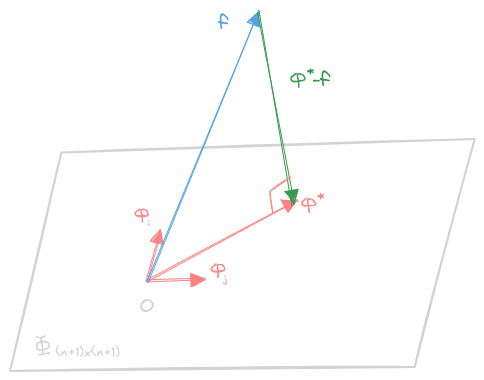
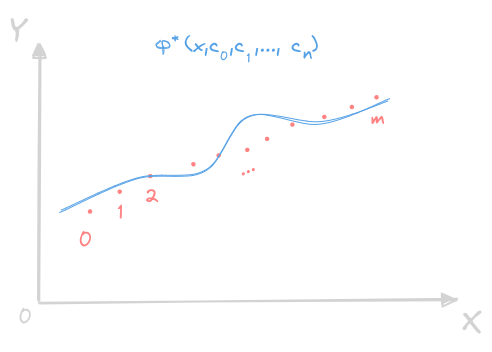

# 函数的最佳平方逼近与数据的最小二乘拟合
---
要衡量近似函数和被近似函数的**逼近程度**，本章主线就是找衡量标准
## 预备知识

### 赋范线性空间与内积空间
- 赋范线性空间：
    - 在线性空间 $\bm V$ 中找 $f(x)$ 的“最好近似”——距离 $f(x)$ 最近
    - 函数的范数：定义于线性空间 $\bm V$ 上的泛函（实值函数）$\Vert * \Vert$，满足：
        - 非负性：$\forall f \in\bm V\left((\Vert f\Vert\geq 0)\wedge((\Vert f\Vert=0)\iff(f = 0 ))\right)$ 
        - 齐次性：$\forall f\in\bm V,\alpha\in\mathbb R(\Vert\alpha f\Vert=\vert\alpha\vert\Vert f\Vert)$
        - 三角不等式：$\forall f,g\in\bm V(\Vert f+g\Vert\leq\Vert f\Vert+\Vert g\Vert)$
    
        则称 $\Vert * \Vert$ 是线性空间 $\bm V$ 上的一种范数，且**具有范数的线性空间 $\bm V$ 为赋范线性空间**
    - 定义在 $\bm V$ 上的范数也是其子空间 $\bm V_{1}$ 上的范数
    - 设区间 $[a,b]$，其连续函数集合为 $C[a,b]$，这是一个**线性空间**，定义泛函 $\Vert * \Vert_{2}$：
        $$
        \Vert f\Vert_{2} = \left(\int_{a}^{b}f^{2}(x)\mathrm dx\right)^{\frac{1}{2}}
        $$
        可得 $\Vert * \Vert_{2}$ 是线性空间 $C[a,b]$ 上的范数，线性空间 $C[a,b]$ 关于范数 $\Vert * \Vert_{2}$ 是一种**赋范线性空间**，记为 $\left(C[a,b],\Vert * \Vert_{2}\right)$
    - 设 $f, g\in(\bm V,\Vert * \Vert)$，定义其距离为：
        $$
        d(f,g) = \Vert f - g \Vert
        $$
        特别地，对于 $f,g\in\left(C[a,b],\Vert * \Vert_{2}\right)$，其距离为：
        $$
        d(f,g) = \Vert f - g \Vert_{2} = 
        \left(\int_{a}^{b}\left(f(x)-g(x)\right)^{2}\mathrm dx\right)^{\frac{1}{2}}
        $$
- 内积空间
    - 设 $\bm V$ 为线性空间，定义一个**二元实值函数**（二元泛函）$(*,*)$，满足：
        - 非负性：$\forall f \in\bm V\left(\left((f,f)\geq 0\right)\wedge(\left((f,f) =  0\right)\iff(f = 0 ))\right)$ 
        - 线性性：$\forall f,g,h \in\bm V;a,b\in\mathbb R\left((af+bg,h) = a(f,h) + b(g,h)\right)$ 
        - 对称性：$\forall f,g \in\bm V\left((f,g) = (g,f)\right)$ 

        则 $(*,*)$ 是线性空间 $\bm V$ 里的一种**内积**，称 $\bm V$ 关于实值函数 $(*,*)$ 为**内积空间**
    - 利用的对称性和线性性，不难得到  
        $$\forall f\in\bm V\left((0,f)=(f,0)=0\right)$$
        若 $\bm V_{1}\leq\bm V$，则 $\bm V_{1}$ 关于 $\bm V$ 的内积也构成**内积空间**
    - 定义于 $[a,b]$ 上的实值函数 $\rho(x)$
        - $\forall x\in[a,b](\rho(x)\geq0)$ 
        - $\displaystyle\int_{a}^{b}\rho(x)\geq 0$
        - $\displaystyle\int_{a}^{b}x^{k}\rho(x),(k=0,1,\cdots)$ 存在

        则称 $\rho(x)$ 为区间 $[a,b]$ 上的一个**权函数**
    - 在线性空间 $C[a,b]$ 上定义二元实值函数为**带权内积**：
        $$(f,g)_{\rho} = \int_{a}^{b}f(x)g(x)\rho(x)\mathrm dx$$
        其中 $f,g\in C[a,b]$，且线性空间 $C[a,b]$ 关于该定义的内积是一个内积空间，约定默认权函数为 $\rho(x)\equiv 1$
    - Minkowski 三角不等式：
        $$
        \sqrt{\int_{a}^{b}(f(x)+g(x))^{2}\mathrm dx}
        \leq
        \sqrt{\int_{a}^{b}f^{2}(x)\mathrm dx}+\sqrt{\int_{a}^{b}g^{2}(x)\mathrm dx}
        $$ 
    - Schwarz 不等式：
        $$
        \left((f,g)_{\rho}^{2}\leq(f,f)_{\rho}(g,g)_{\rho}\right)\iff
        \left(
        \left(\int_{a}^{b}f(x)g(x)\rho(x)\mathrm dx\right)^{2}
        \leq
        \left(\int_{a}^{b}f^{2}(x)\rho(x)\mathrm dx\right)
        \left(\int_{a}^{b}g^{2}(x)\rho(x)\mathrm dx\right)
        \right)
        $$ 
    - 可以将 $(f,f)^{\frac{1}{2}}$ 看成内积空间 $\bm V$ 上的定义的范数，也即**由内积诱导出的范数**，内积空间**关于其诱导范数是一个赋范线性空间**
- 设 $\varphi_{0},\varphi_{1},\cdots,\varphi_{n}$ 为**内积空间** $\bm\Phi$ 上的一组元素，这组元素定义了一个 **Gram 矩阵**：
    $$
    \bm G_{n} = \bm\Phi^{\mathrm T}\bm\Phi =
    \begin{bmatrix}
    \varphi_{0} \\ \varphi_{1} \\ \vdots \\ \varphi_{n}
    \end{bmatrix}
    \begin{bmatrix}
    \varphi_{0} & \varphi_{1} & \cdots & \varphi_{n}
    \end{bmatrix}
    =
    \begin{bmatrix}
    (\varphi_{0},\varphi_{0}) & (\varphi_{0},\varphi_{1}) & \cdots & (\varphi_{0},\varphi_{n})\\
    (\varphi_{1},\varphi_{0}) & (\varphi_{1},\varphi_{1}) & \cdots & (\varphi_{1},\varphi_{n})\\
    \vdots & \vdots & \ddots & \vdots\\
    (\varphi_{n},\varphi_{0}) & (\varphi_{n},\varphi_{1}) & \cdots & (\varphi_{n},\varphi_{n})\\
    \end{bmatrix}
    $$
    这组**元素线性无关等价于 $\det\bm G_{n}\neq 0$，并且 $\bm G_{n}$ 实对称正定**！（可以用 $\bm G_{n}\bm c=\bm 0$ 只有零解去证明）

### 正交多项式系
- 正交多项式系的定义及性质
    - 在内积空间上，$f$ 和 $g$ 内积 $(f,g)=0$，则 $f,g$ 关于内积 $(*,*)$ 正交
    - 正交系：
        $$
        \{f_{i}\} := 
        \begin{cases}
        (f_{i},f_{j}) = 0,\qquad(i\neq j)\\
        (f_{i},f_{i}) = \gamma_{i}\geq 0\\
        \end{cases}
        $$
    - 标准正交系：
        $$
        \{f_{i}\} := \left((f_{i},f_{j}) = \delta_{ij}\right)
        $$
        如：$1,\sin x,\cos x, \sin2x,\cos2x,\cdots$ 在 $[0,2\pi]$ 上关于权函数 $\rho(x)\equiv 1$ **两两正交**，当 $f_{i}$ 为 $i$ 次多项式的时候，该函数系为**正交多项式系**
    - 正交多项式系的性质：
        - 正交多项式系的任意 $m$ 个函数线性无关
        - $f_{n+1}$ 和任意不超过 $n$ 次的多项式 $p_{n}$ 正交
        - $f_{n},\,\,(n\geq 1)$ 在区间 $(a,b)$ 内有 $n$ 个互不相同的实零点
        - $f_{k+1},f_{k},f_{k-1}$ 存在如下关系：
            $$
            f_{k+1} = 
            \left[
            \frac{a_{k+1}^{(0)}}{a_{k}^{(0)}}x+
            \frac{a_{k+1}^{(0)}}{a_{k}^{(0)}}\left(
                \frac{a_{k+1}^{(1)}}{a_{k+1}^{(0)}} - \frac{a_{k}^{(1)}}{a_{k}^{(0)}}
            \right)    
            \right]f_{k} - 
            \left[
            \frac{a_{k+1}^{(0)}/a_{k}^{(0)}}{a_{k}^{(0)}/a_{k-1}^{(0)}}
            \frac{(f_{k},f_{k})}{(f_{k-1},f_{k-1})}
            \right]
            f_{k-1}
            $$
            可以利用正交性和系数相消去推导，并且如果首系数归一化：
            $$g_{i} = \frac{f_{i}}{a_{i}^{(0)}}$$
            此时：
            $$
            \frac{f_{k+1}}{a_{k+1}^{(0)}} = \left(x+
                \frac{a_{k+1}^{(1)}}{a_{k+1}^{(0)}} - \frac{a_{k}^{(1)}}{a_{k}^{(0)}}
                \right)\frac{f_{k}}{a_{k}^{(0)}} - 
            \frac
            {(f_{k}/a_{k}^{(0)},f_{k}/a_{k}^{(0)})}
            {(f_{k-1}/a_{k-1}^{(0)},f_{k-1}/a_{k-1}^{(0)})}\frac{f_{k-1}}{a_{k-1}^{(0)}}
            $$
            也即：
            $$
            g_{k+1}= \left(x+b_{k+1}^{(1)}- b_{k}^{(1)}\right)g_{k}-
            \frac
            {(g_{k},g_{k})}
            {(g_{k-1},g_{k-1})}g_{k-1}            
            $$
            下面推导 $b_{k+1}^{(1)}- b_{k}^{(1)}$，首先 $g_{k}$ 和所有小于 $k$ 次 $g_{i}$ 正交：
            $$
            (g_{k+1},g_{k}) = (xg_{k},g_{k}) + \left(b_{k+1}^{(1)}- b_{k}^{(1)}\right)(g_{k}.g_{k}) -
            \frac
            {(g_{k},g_{k})}
            {(g_{k-1},g_{k-1})}(g_{k-1},g_{k}) = 0
            $$
            因此：
            $$
            0 = (xg_{k},g_{k}) + \left(b_{k+1}^{(1)}- b_{k}^{(1)}\right)(g_{k}.g_{k}) - 0
            $$
            整理得到：
            $$
            \left(b_{k+1}^{(1)}- b_{k}^{(1)}\right) = -\frac{(xg_{k},g_{k})}{(g_{k}.g_{k})}
            $$
            最终可以得到**首 $1$ 系数的正交多项式系**的递推关系：
            $$
            \begin{cases}
            g_{0}\equiv 1\\
                \\
            g_{1} = x - \displaystyle\frac{(x,1)}{(1,1)}\\
                \\
            g_{k+1} = 
            \left(x-\displaystyle\frac{(xg_{k},g_{k})}{(g_{k},g_{k})}\right)g_{k} -
            \displaystyle\frac
            {(g_{k},g_{k})}
            {(g_{k-1},g_{k-1})}g_{k-1}            
            \end{cases}
            $$
            因此当内积、权函数和积分区间给定，首 $1$ 的正交多项式系**唯一确定**
- 常用的正交多项式系：
    - Legrende 多项式系：
        - 其定义和首项、次项系数为：
            $$
            \begin{cases}
            P_{0} = 1\\
                \\
            P_{n} = \displaystyle\frac{1}{2^{n}n!}\frac{\mathrm d^{n}}{\mathrm dx^{n}}(x^{2}-1)^{n}
            \qquad(n=1,2,\cdots)\\
            \end{cases}
            $$
        - 其首项、次项系数为：
            $$
            \begin{cases}
            a_{n}^{(0)} = 
            \displaystyle\frac{1}{2^{n}n!}
            \displaystyle\prod_{i=0}^{n-1}(2n-i) = 
            \displaystyle\frac{(2n)!}{2^{n}(n!)^{2}}\\
                \\
            a_{n}^{(1)} = 0
            \end{cases}
            $$
        - 这个多项式系每一个多项式都是**隔项相加**，因此 $P_{n}(-x)=(-1)^{n}P_{n}(x)$
        - 且多项式系是 $[-1,1]$ 上关于权函数 $\rho(x)\equiv 1$ 的正交多项式系，满足：
            $$
            (P_{i},P_{j})_{1} = \int_{-1}^{1}P_{i}(x)P_{j}(x)\mathrm dx = 
            \frac{(-1)^{i}}{2^{j}j!}a_{i}^{(0)}i!
            \int_{-1}^{1}\frac{\mathrm d^{j-1}}{\mathrm dx^{j-1}}
            (x^{2}-1)^{j}
            \mathrm dx=
            \begin{cases}
            0,\qquad i\neq j\\
            \\
            \displaystyle\frac{2}{2i+1},\qquad i=j
            \end{cases}
            $$
            注意，这里当 $i=j$ 的时候，有：
            $$
            (P_{i},P_{i})_{1} = \int_{-1}^{1}P_{i}^{2}(x)\mathrm dx = 
            \frac{(2i)!}{(2^{i}i!)^{2}}
            \int_{0}^{\frac{\pi}{2}}
            2\cos^{2i+1}\theta\mathrm d\theta
            =
            \frac{(2i)!}{(2^{i}i!)^{2}}\times
            2\times\frac{(2i)!!}{(2i+1)!!}
            $$
            也即：
            $$
            (P_{i},P_{i})_{1} = 
            \frac{(2i)!}{(2^{i}i!)^{2}}
            \times\frac{(2i)!!}{(2i-1)!!}\times
            \frac{2}{2i+1}
            = \frac{2}{2i+1}
            $$
            这里用到了**点火公式**：
            $$
            \int_{0}^{\frac{\pi}{2}}\cos^{2i+1}\theta\mathrm d\theta = 
            \frac{2i}{2i+1}\times\frac{2i-2}{2i-1}\times\frac{2i-4}{2i-3}\times\cdots
            \frac{4}{5}\times\frac{2}{3}\times\frac{1}{1} = 
            \frac{(2i)!!}{(2i+1)!!}
            $$
        - 利用内积、权函数为 $\rho(x)\equiv1$、积分区间和首项、次项系数，可以推出 Legrende 多项式的**递推关系**
            $$
            \begin{cases}
            P_{0} = 1\\
                \\
            P_{1} = x\\
                \\
            P_{n+1} = 
            \displaystyle\frac{2n+1}{n+1}xP_{n}(x) - 
            \displaystyle\frac{n}{n+1}P_{n-1}(x),
            \qquad (n=1,2,\cdots)
            \end{cases}
            $$
    - Chebyshev 多项式系
        - 定义于 $[-1,1]$ 上有一个耦合**余弦**和**反余弦**的函数系：
            $$
            T_{n}(x) = \cos(n\arccos(x)) = 
            \begin{cases}
            T_{0} = 1\\
                \\
            T_{1} = x\\
                \\
            T_{n+1}(x) = 2xT_{n}(x) - T_{n-1}(x),\qquad(n=1,2,\cdots)
            \end{cases}
            $$
            这里可以借助 $\theta=\arccos(x)\in[0,\pi]$，再利用**和差化积**公式：
            $$
            \begin{cases}
            x = \cos(\theta)\\
            \\
            T_{n}(x) = \cos(n\theta)\\
            \\
            \cos\left((n+1)\theta\right) - \cos\left((n-1)\theta\right) = 
            2\cos(n\theta)\cos(\theta)\\
            \end{cases}
            $$
            得到第三个式子
        - 其首项系数和多项式系满足：：
            $$
            \begin{cases}
            a_{n}^{(0)} = 2^{n-1}\\
                \\
            \vert T_{n}(x)\vert = \vert \cos(n\arccos(x))\vert \leq 1\\
                \\
            T_{n}(-x) = \cos(n\arccos(-x)) = 
            \cos(n(\pi-\arccos(x))) = 
            (-1)^{n}T_{n}(x)
            \end{cases}
            $$
        - 其零点和极值点满足：
            $$
            \begin{cases}
            (T_{n}(\alpha_{p})=0)
            \implies
            \left(n\arccos(\alpha_{p}) = \displaystyle\frac{2i+1}{2}\pi\right)
            \implies 
            \left(\alpha_{p} = \cos\left(\displaystyle\frac{2i+1}{2n}\pi\right)\right)\\
            \\
            \left(T_{n}'(\beta_{q})=0\right) \implies
            \left(n\arccos(\beta_{q}) = \displaystyle\frac{2j}{2}\pi\right)
            \implies 
            \left(\beta_{q} = \cos\left(\displaystyle\frac{2j}{2n}\pi\right)\right)\\
            \end{cases}
            $$
            在区间 $[-1,1]$ 上有 $n$ 个零点 $p=0,1,\cdots,n-1$，和 $n+1$ 个极值点（最值点） $q=0,1,\cdots,n$
        - 其在区间 $[-1,1]$ 上关于权函数 $\rho(x) = \displaystyle\frac{1}{\sqrt{1-x^{2}}} = \displaystyle\frac{1}{\sin\theta}$ 正交：
            $$
            \begin{align*}
            (T_{i},T_{j})_{\rho} =& 
            \int_{-1}^{1}T_{i}(x)T_{j}(x)\rho(x)\mathrm dx =
            \int_{\pi}^{0}
            \cos(i\theta)\cos(j\theta)
            \frac{1}{\sin\theta}(-\sin\theta)
            \mathrm d\theta\\
                \\
            =&
            \int_{0}^{\pi}
            \cos(i\theta)\cos(j\theta)
            \mathrm d\theta
            =
            \begin{cases}
            0,\qquad i\neq j\\
                \\
            \displaystyle\frac{\pi}{2},\qquad i = j \neq 0\\
                \\
            \displaystyle\pi,\qquad i = j = 0\\
            \end{cases}
            \end{align*}
            $$
            这里用到了三角函数系的正交性
- Laguerre 多项式系
    - 定义：
        $$
        L_{n}(x) =  \mathrm e^{x}\frac{\mathrm d^{n}}{\mathrm dx^{n}}(x^{n}\mathrm e^{-x})
        \qquad
        (n=0,1,\cdots)
        $$
    - 在区间 $[0,+\infty)$ 上关于权函数 $\rho(x) = \mathrm e^{-x}$ 的正交多项式系，且：
        $$
        (L_{i},L_{j})_{\rho} = 
        \int_{0}^{+\infty}L_{i}(x)L_{j}(x)\rho(x)\mathrm dx =
        \int_{0}^{+\infty}
        \mathrm e^{x}
        \left(\frac{\mathrm d^{i}}{\mathrm dx^{i}}(x^{i}\mathrm e^{-x})\right)
        \left(\frac{\mathrm d^{j}}{\mathrm dx^{j}}(x^{j}\mathrm e^{-x})\right)
        \mathrm dx =
        \begin{cases}
        0,\qquad i\neq j\\
            \\
        (i!)^{2},\qquad i = j\\
        \end{cases}
        $$
    - 首项系数和次项系数，以及三项递推关系满足：
        $$
        \begin{cases}
        a_{n}^{(0)} = (-1)^{n}\\
            \\
        a_{n}^{(1)} = (-1)^{n-1}n^{2}\\
        \end{cases}
        \qquad\implies\qquad
        \begin{cases}
        L_{0}(x) = 1\\
            \\
        L_{1}(x) = 1-x\\
            \\
        L_{n+1}(x) = (1+2n-x)L_{n}(x) - n^{2}L_{n-1}(x),\qquad (n=1,2,\cdots)\\
        \end{cases}
        $$
- Hermite 多项式系
    - 定义：
        $$
        H_{n}(x) = (-1)^{n}\mathrm e^{x^{2}}\frac{\mathrm d^{n}}{\mathrm dx^{n}}\mathrm e^{-x^{2}}
        \qquad
        (n=0,1,\cdots)
        $$
    - 其在区间 $(-\infty,\infty)$ 上关于权函数 $\rho(x) = \mathrm e^{-x^{2}}$ 正交：
        $$
        (H_{i},H_{j})_{\rho} = 
        \int_{-\infty}^{+\infty}H_{i}(x)H_{j}(x)\rho(x)\mathrm dx =
        \int_{-\infty}^{+\infty}
        \mathrm e^{x^{2}}
        \left(\frac{\mathrm d^{i}}{\mathrm dx^{i}}\mathrm e^{-x^{2}}\right)
        \left(\frac{\mathrm d^{j}}{\mathrm dx^{j}}\mathrm e^{-x^{2}}\right)
        \mathrm dx =
        \begin{cases}
        0,\qquad i\neq j\\
        2^{i}i!\sqrt\pi,\qquad i = j\\
        \end{cases}
        $$
    - 首项系数，次项系数和三项递推式为：
        $$
        \begin{cases}
        a_{n}^{(0)} = 2^{n}\\
            \\
        a_{n}^{(1)} = 0
        \end{cases}
        \qquad\implies\qquad
        \begin{cases}
        H_{0}(x) = 1\\
            \\
        H_{1}(x) = 2x\\
            \\
        H_{n+1}(x) = 2xH_{n}(x) - 2nH_{n-1}(x),\qquad (n=1,2,\cdots)\\
        \end{cases}
        $$
    - 并且 Hermite 多项式系也满足 $H_{n}(-x) = (-1)^{n}H_{n}(x)$
- 注意，Legrende 多项式系、Chebyshev 多项式系和 Hermite 多项式系都和三角函数及其导数挂钩，并且很巧合的是，他们都满足 $f_{n}(-x) = (-1)^{n}f_{n}(x)$

## 连续函数的最佳平方逼近
- 设 $C[a,b]$ 表示由 $[a,b]$ 上的连续函数构成的线性空间，关于内积 $(*,*)_{\rho}$ 构成内积空间，诱导范数为：
    $$
    \Vert f\Vert_{2} = 
    \left((f,f)_{\rho}\right)^{\frac{1}{2}} = 
    \left[\int_{a}^{b}f^{2}(x)\rho(x)\mathrm dx\right]^{\frac{1}{2}},\qquad
    \forall f\in C[a,b]
    $$
    也即 $C[a,b]$ 关于内积诱导范数是**赋范线性空间**
- 设：
    $$
    \bm \Phi_{(n+1)\times (n+1)} = 
    \mathrm{span}(\varphi_{0},\varphi_{1},\cdots,\varphi_{n})\leq C[a,b]
    $$
    其中 $\{\varphi_{i}\}$ 是一组基，用**赋范内积**诱导的**范数**定义**函数的长度**，然后找一个该基的的线性组合（向量） $\varphi$ 来逼近函数 $f$
- 最佳逼近，说直白点就是**残差加权范数最小**，定义残差为**逼近函数和被逼近函数的差**：
    $$
    r = f-\varphi
    $$
    求解目标：
    $$
    \varphi(x):= \min\Vert f-\varphi\Vert_{2}
    $$
    也即：
    $$
    \varphi(x):= 
    \min\left[
    \int_{a}^{b}(f(x)-\varphi(x))^{2}\rho(x)\mathrm dx
    \right]^{\frac{1}{2}}
    $$
    又因为算术平方根本身为递增函数，目标便是根据给定的基 $\{\varphi_{i}\}$，找到一个合适的坐标 $\bm c$：
    $$
    \bm c:=
    \min
    \int_{a}^{b}\left(f-\sum_{i=0}^{n}c_{i}\varphi_{i}\right)^{2}\rho\mathrm dx
    $$
    使用内积形式来表达：
    $$
    \bm c:=
    \min
    \left(f-\sum_{i=0}^{n}c_{i}\varphi_{i},\,\,\,\,f-\sum_{i=0}^{n}c_{i}\varphi_{i}\right)_{\rho}
    $$

- 这种利用**带权内积诱导范数**定义“函数长度”来寻找最佳逼近函数的问题，叫做**最佳平方逼近**

### 最佳平方逼近的求解
- 下面用**默认权函数 $\rho(x)\equiv1$ 为例**，利用内积的性质，设目标函数：
    $$
    I(\bm c) = 
    \left(f-\sum_{i=0}^{n}c_{i}\varphi_{i},f-\sum_{i=0}^{n}c_{i}\varphi_{i}\right) =
    (f,f)-
    2\left(f,\sum_{i=0}^{n}c_{i}\varphi_{i}\right)+
    \left(\sum_{i=0}^{n}c_{i}\varphi_{i},\sum_{i=0}^{n}c_{i}\varphi_{i}\right)
    $$
    化简：
    $$
    \begin{align*}
    I(\bm c) 
    =& 
    (f,f)-
    2\sum_{i=0}^{n}(f,\varphi_{i})c_{i}+
    \sum_{i=0}^{n}\sum_{j=0}^{n}c_{i}(\varphi_{i},\varphi_{j})c_{j} \\
    =&
    (f,f)-
    2(\bm f_{\bm\Phi})^{\mathrm T}\bm c+
    (\bm\Phi\bm c)^{\mathrm T}(\bm\Phi\bm c)\\
    =&
    (f,f)-
    2(\bm f_{\bm\Phi})^{\mathrm T}\bm c+
    \bm c^{\mathrm T}\left(\bm\Phi^{\mathrm T}\bm\Phi\right)\bm c\\
    =&
    (f,f)-
    2(\bm f_{\bm\Phi})^{\mathrm T}\bm c+
    \bm c^{\mathrm T}\bm G_{n}\bm c\\
    \end{align*}
    $$
    这里的两个矩阵为：
    $$
    \bm\Phi = 
    \begin{bmatrix}
    \varphi_{0} & \varphi_{1} & \cdots & \varphi_{n}
    \end{bmatrix}\,\qquad
    \bm G_{n} = \bm\Phi^{\mathrm T}\bm\Phi =
    \begin{bmatrix}
    (\varphi_{0},\varphi_{0}) & (\varphi_{0},\varphi_{1}) & \cdots & (\varphi_{0},\varphi_{n})\\
    (\varphi_{1},\varphi_{0}) & (\varphi_{1},\varphi_{1}) & \cdots & (\varphi_{1},\varphi_{n})\\
    \vdots & \vdots & \ddots & \vdots\\
    (\varphi_{n},\varphi_{0}) & (\varphi_{n},\varphi_{1}) & \cdots & (\varphi_{n},\varphi_{n})\\
    \end{bmatrix}
    $$
    其中：
    $$
    \bm c = 
    \begin{bmatrix}
    c_{0} \\ 
    c_{1} \\ 
    \vdots\\
    c_{n}
    \end{bmatrix},\qquad
    \bm f_{\bm\Phi} = 
    \begin{bmatrix}
    (f,\varphi_{0}) \\ 
    (f,\varphi_{1}) \\ 
    \vdots\\
    (f,\varphi_{n})
    \end{bmatrix}
    $$
    这里 $(f,f)$ 是固定的，所以只需要求：
    $$
    \bm c:=
    \min 
    \left(\bm c^{\mathrm T}\bm G_{n}\bm c - 2(\bm f_{\bm\Phi})^{\mathrm T}\bm c\right)
    $$
- 注意，$\bm G_{n}$ 是实对称正定矩阵，因此其特征值都大于零，可逆且可正交对角化（酉相似）：
    $$
    \bm G_{n} = \bm Q^{\mathrm T}\bm \Lambda\bm Q,\qquad \bm Q^{\mathrm T}\bm Q =\bm I
    $$
    则：
    $$
    \bm q = \bm Q\bm c\qquad\iff\qquad\bm c = \bm Q^{-1}\bm q = \bm Q^{\mathrm T}\bm q
    $$
    设函数：
    $$
    F(\bm c) = 
    \bm c^{\mathrm T}\bm G_{n}\bm c - 2(\bm f_{\bm\Phi})^{\mathrm T}\bm c= 
    \bm c^{\mathrm T}\bm Q^{\mathrm T}\bm \Lambda\bm Q\bm c - 
    2(\bm f_{\bm\Phi})^{\mathrm T}\bm c = 
    \bm q^{\mathrm T}\bm \Lambda\bm q - 2(\bm f_{\bm\Phi})^{\mathrm T}\bm Q^{\mathrm T}\bm q
    $$
    由于正交变换保距，改成：
    $$
    H(\bm q) = 
    \bm q^{\mathrm T}\bm \Lambda\bm q - 2(\bm Q\bm f_{\bm\Phi})^{\mathrm T}\bm q =
    \bm q^{\mathrm T}\bm \Lambda\bm q - 2\bm m^{\mathrm T}\bm q =
    \sum_{i=0}^{n}\lambda_{i}q_{i}^{2}-2\sum_{i=0}^{n}m_{i}q_{i}
    $$
    其取得极值的条件为：
    $$
    \frac{\partial H}{\partial q_{i}} = 2\lambda_{i}q_{i}-2m_{i} = 0
    $$
    也即：
    $$
    q_{i} = \frac{m_{i}}{\lambda_{i}}
    \qquad\iff\qquad 
    \bm q = \bm\Lambda^{-1}\bm Q\bm f_{\bm\Phi}
    $$
    带回到 $\bm q=\bm Q\bm c$：
    $$
    \bm\Lambda\bm Q\bm c = \bm Q\bm f_{\bm\Phi}
    $$
    再构造 $\bm Q^{\mathrm T}\bm Q=\bm I$ 可以得到：
    $$
    \bm Q^{\mathrm T}\bm\Lambda\bm Q\bm c = \bm f_{\bm\Phi}
    $$
    因此使得 $F(\bm c)$ 取得极值的点 $\bm c$ 恰好满足：
    $$
    \bm G_{n}\bm c = \bm f_{\bm\Phi}
    $$
    而 $\bm G_{n}$ 非奇异且实对称正定，可逆，线性方程组**有唯一解**，并且由于其特征值都大于 $0$，故
    $$
    \frac{\partial^{2} H}{\partial q_{i}^{2}} = 2\lambda_{i} > 0,\qquad
    \frac{\partial^{2} H}{\partial q_{i}\partial q_{j}} = 0
    $$
    故 Hessian 行列式：
    $$
    \begin{vmatrix}
    H_{q_{0}q_{0}} & H_{q_{0}q_{1}} & \cdots & H_{q_{0}q_{n}}\\
    H_{q_{1}q_{0}} & H_{q_{1}q_{1}} & \cdots & H_{q_{1}q_{n}}\\
    \vdots & \vdots & \ddots & \vdots\\
    H_{q_{n}q_{0}} & H_{q_{n}q_{1}} & \cdots & H_{q_{n}q_{n}}\\
    \end{vmatrix} =
    \begin{vmatrix}
    2\lambda_{0} & 0 & \cdots & 0\\
    0 & 2\lambda_{1} & \cdots & 0\\
    \vdots & \vdots & \ddots & \vdots\\
    0 & 0 & \cdots & 2\lambda_{n}\\
    \end{vmatrix} =2^{n+1}\det(\bm G_{n}) > 0
    $$
    其一定取得极值点，且**方向导数始终大于 $0$，故取得最小值**
- 综上，满足：
    $$
    \bm c:=
    \min 
    \left(\bm c^{\mathrm T}\bm G_{n}\bm c - 2(\bm f_{\bm\Phi})^{\mathrm T}\bm c\right)
    $$
    的 $\bm c$，是
    $$
    \bm G_{n}\bm c = \bm f_{\bm\Phi}
    $$
    的解，展开成矩阵形式，给定基 $\{\varphi_{i}\}$ 和被逼近函数 $f$，则需要求解系数 $\bm c$：
    $$
    \begin{bmatrix}
    (\varphi_{0},\varphi_{0}) & (\varphi_{0},\varphi_{1}) & \cdots & (\varphi_{0},\varphi_{n})\\
    (\varphi_{1},\varphi_{0}) & (\varphi_{1},\varphi_{1}) & \cdots & (\varphi_{1},\varphi_{n})\\
    \vdots & \vdots & \ddots & \vdots\\
    (\varphi_{n},\varphi_{0}) & (\varphi_{n},\varphi_{1}) & \cdots & (\varphi_{n},\varphi_{n})\\
    \end{bmatrix}
    \begin{bmatrix}
    c_{0} \\ 
    c_{1} \\ 
    \vdots\\
    c_{n}
    \end{bmatrix} = 
    \begin{bmatrix}
    (f,\varphi_{0}) \\ 
    (f,\varphi_{1}) \\ 
    \vdots\\
    (f,\varphi_{n})
    \end{bmatrix}
    $$
    这便是最佳平方逼近问题的**法方程组**或**正规方程组**，这里最佳平方逼近函数为：
    $$
    \varphi^{*} = \sum_{i=0}^{n}c_{i}\varphi_{i}
    $$
    如果将法方程组展开成内积对应相等的格式，对于第 $k$ 个分量：
    $$
    \sum_{i=0}^{n}(\varphi_{k},\varphi_{i})c_{i} = (f,\varphi_{k})
    $$
    利用内积的线性性：
    $$
    \sum_{i=0}^{n}(\varphi_{k},\varphi_{i})c_{i} = 
    \left(\varphi_{k},\sum_{i=0}^{n}c_{i}\varphi_{i}\right) =
    (\varphi_{k},\varphi^{*}) = 
    (\varphi^{*},\varphi_{k})
    $$
    因此又可以得到**法方程组的等价形式**：
    $$
    (\varphi^{*}, \varphi_{k}) = (f,\varphi_{k}),\qquad(k=0,1,\cdots,n)
    $$
    这样最佳平方逼近函数保证了和被逼近函数在**内积诱导的赋范线性空间 $C[a,b]$ 上的内积一致**，又可以得到**法方程组的必要条件**：
    $$
    \left(\sum_{k=0}^{n}(\varphi^{*}, \varphi_{k})c_{k} = \sum_{k=0}^{n}(f,\varphi_{k})c_{k}\right)
    \implies
    \left((\varphi^{*}, \varphi^{*}) = (f,\varphi^{*})\right)
    \implies
    \left((\varphi^{*}-f, \varphi^{*}) = 0\right)
    $$
    这说明**最佳平方逼近函数和其与被逼近函数的残差的内积为零**！注意，$f$ 和 $\varphi^{* },\varphi_{i}$ 本身都是内积诱导的赋范线性空间 $C[a,b]$ 中的**向量**，因此可以理解成 $f$ 在子空间 $\Phi_{(n+1)\times(n+1)}$ 上的**投影**是 $\varphi^{* }$

- 因此，进一步地，又可以根据范数作为函数长度的度量来求最佳平方逼近的**平方逼近误差**:
    $$
    \Vert \varphi^{* }-f\Vert_{2}^{2} = 
    (\varphi^{* }-f, \varphi^{* }-f) = (\varphi^{* }, \varphi^{* }) - 2(f,\varphi^{* })+(f,f) =
     (f,f) - (f,\varphi^{* })
    $$
    因此：
    $$
    \Vert \varphi^{* }-f\Vert_{2}^{2} = (f,f) - \sum_{k=0}^{n}(f,\varphi_{k})c_{k} =
    (f,f) - \bm f_{\bm\Phi}^{\mathrm T}\bm c
    $$
    当 $f\in\bm\Phi_{(n+1)\times(n+1)}$ 的时候，$f$ 在内积空间上 $\Phi_{(n+1)\times(n+1)}$ 的投影就是它自身，也即 $\varphi^{* }=f$，这里的平方逼近误差可以利用内积的定义做变形：
    $$
    \Vert \varphi^{* }-f\Vert_{2}^{2} = (f,\,\,\,f-\varphi^{* })
    $$
    但为了更加凸显 $\bm c$ 对残差的影响，日后以 $\Vert \varphi^{* }-f\Vert_{2}^{2} = (f,f) - \bm f_{\bm\Phi}^{\mathrm T}\bm c$ 来计算平方逼近误差为主
- 当 $[a,b]=[0,1]$，取 $\rho(x)\equiv1$，取 $\Phi_{(n+1)\times(n+1)} = \text{span}\{1,x,\cdots,x^{n}\}$，此时法方程组的系数矩阵为 Hilbert 矩阵，法方程组为：
    $$
    \begin{bmatrix}
    1 & \displaystyle\frac{1}{2} & \cdots & \displaystyle\frac{1}{n+1} \\
        \\
    \displaystyle\frac{1}{2} & \displaystyle\frac{1}{3} & \cdots & \displaystyle\frac{1}{n+2} \\
        \\
    \vdots & \vdots & \ddots & \vdots\\
        \\
    \displaystyle\frac{1}{n+1} & \displaystyle\frac{1}{n+2} & \cdots & \displaystyle\frac{1}{2n+1} \\
    \end{bmatrix}
    \begin{bmatrix}
    c_{0} \\ 
    \\
    c_{1} \\ 
    \\
    \vdots\\
    \\
    c_{n}
    \end{bmatrix} = 
    \begin{bmatrix}
    \displaystyle\int_{0}^{1}f(x)\mathrm dx \\ 
    \\
    \displaystyle\int_{0}^{1}xf(x)\mathrm dx \\ 
    \\
    \vdots\\
    \\
    \displaystyle\int_{0}^{1}x^{n}f(x)\mathrm dx \\ 
    \end{bmatrix}
    $$
    当 $n$ 较大的时候，这个线性方程组是病态的，求解过程的**舍入误差**对解的影响很大，为减少舍入误差的影响和求解过程的计算量，需要选择合适的基

### 基于正交函数基的最佳平方逼近
- 当选择的基为正交基的时候：
    $$(\varphi_{i}.\varphi_{j}) = 0,\qquad(i\neq j)$$
    则系数矩阵为：
    $$
    \bm G_{n} = 
    \begin{bmatrix}
    (\varphi_{0},\varphi_{0}) \\
        \\
    & (\varphi_{1},\varphi_{1}) \\
        \\
    &&\ddots\\
        \\
    &&& (\varphi_{n},\varphi_{n}) \\
    \end{bmatrix}
    $$
    求解相应的法方程组很简单，可以直接得到：
    $$
    \bm c = 
    \begin{bmatrix}
    \displaystyle\frac{(\varphi_{0},f)}{(\varphi_{0},\varphi_{0})}\\
        \\
    \displaystyle\frac{(\varphi_{1},f)}{(\varphi_{1},\varphi_{1})}\\
        \\
        \vdots\\
        \\
    \displaystyle\frac{(\varphi_{n},f)}{(\varphi_{n},\varphi_{n})}\\
    \end{bmatrix}
    $$
    相应的最佳平方逼近函数为：
    $$
    \varphi^{* }(x) = 
    \displaystyle\frac{(\varphi_{0},f)}{(\varphi_{0},\varphi_{0})}\varphi_{0} +
    \displaystyle\frac{(\varphi_{1},f)}{(\varphi_{1},\varphi_{1})}\varphi_{1} +
    \cdots +
    \displaystyle\frac{(\varphi_{n},f)}{(\varphi_{n},\varphi_{n})}\varphi_{n}
    $$
    平方逼近误差为：
    $$
    \Vert\varphi^{* }-f\Vert_{2}^{2} = (f,f) - 
    \sum_{i=0}^{n}\frac{(f,\varphi_{i})^{2}}{(\varphi_{i},\varphi_{i})}
    $$
- 应当注意，对于给定的内积空间，无论采用哪组基函数，理论分析得到的最佳平方逼近函数都是**恒等**的
- 用的是同一套运算法则，而且**基总是代表着整个内积空间**，最后投影得到的**最佳平方逼近**自然也就是一样的，只是**不同基的线性表示不一样**
- 采用不同基函数导致的最终数值结果是不等效的，使用正交基，计算量小且方法稳定，也可以避免线性方程组的求解
- 使用基函数求解的时候记得注意积分区间的协调，假设积分区间是 $[a,b]$，而正交多项式系对应的积分区间是 $[-1,1]$，这个时候可以做一个双射：
    $$
    x(t) = \frac{a+b}{2} + \frac{b-a}{2}t,\qquad t\in[-1,1]
    $$
    这个时候就变成了关于函数：
    $$
    g(t) = f(x(t))
    $$
    的最佳平方逼近问题，求解得到：
    $$
    \varphi^{* }(t) = 
    \sum_{i=0}^{n}\frac{(g(t),\varphi_{i}(t))}{(\varphi_{i}(t),\varphi_{i}(t))}\varphi_{i}(t)
    $$
    还原得到：
    $$
    \varphi^{* }(t(x)) = \varphi^{* }\left(\frac{2x-a-b}{b-a}\right)
    $$

## 离散数据的曲线拟合
考虑实验观测数据 $\{x_{k},y_{k}\}$，实际应用中并不要求所建立的函数满足所有的观测数据（不然用插值法就完事了），而是在满足数据分布特征的某类函数中，依照标准找到**最好**的函数作为观测数据的连续模型，实现**离散数据的连续化**，也就是**曲线拟合**

### 数据拟合模型及其求解
- 选取曲线的类型，对函数类 $\Phi$ 造型：
    - 以代表元素 $\varphi$ 为拟合模型，其含若干待定参数（一般待定参数个数 $n << m$，这里 $m$ 是离散点的个数）：
        $$\varphi(x) = \varphi(x;c_{0},c_{1},\cdots,c_{n})$$
    - 如果 $\varphi(x)$ 线性依赖于 $\{c_{i}\}$，则为**线性拟合模型**：
        $$\varphi(x) = \sum_{i=0}^{n}c_{i}\varphi_{i}(x)$$
        这里 $\{\varphi_{i}\}$ 是**线性无关**的已知函数组
- 规定标准来确定参数，令 
    $$
    \bm c=
    \begin{bmatrix}
    c_{0} \\ 
    c_{1} \\ 
    \vdots\\
    c_{n}
    \end{bmatrix}
    $$
    这里使用**带权的拟合残差平方和最小**来作为标准：
    $$
    \bm c := \min\left(\sum_{k=0}^{m}\omega_{k}(\varphi(x_{k})-y_{k})^{2}\right)^{\frac{1}{2}}
    $$
    其中 $\omega_{k}>0$ 是第 $k=0,1,\cdots,m$ 个采样点 $(x_{k},y_{k})$ 的**正权值**，可以定义加权对角阵：
    $$
    \bm\Omega = 
    \begin{bmatrix}
    \omega_{0} \\ 
    &\omega_{1} \\ 
    &&\ddots\\
    &&&\omega_{m} \\ 
    \end{bmatrix}
    $$
    另一方面，离散情况下的残差为：
    $$
    r_{k} = \varphi(x_{k})-y_{k},\qquad k=0,1,\cdots,m
    $$
    是相应的**拟合残差**，排列后得到**拟合残差向量**：
    $$
    \bm r = 
    \begin{bmatrix}
    r_{0}(c_{0},c_{1},\cdots,c_{n})\\
    r_{1}(c_{0},c_{1},\cdots,c_{n})\\
    \vdots\\
    r_{m}(c_{0},c_{1},\cdots,c_{m})
    \end{bmatrix} =
    \begin{bmatrix}
    \varphi(x_{0})-y_{0}\\
    \varphi(x_{1})-y_{1}\\
    \vdots\\
    \varphi(x_{m})-y_{m}\\
    \end{bmatrix}
    $$
    定义离散点 $\{x_{k}\}$ 的内积形式（其实就是积分变求和，积分的离散格式就是求和）：
    $$
    (\bm f,\bm g)_{\bm\omega} = \bm f^{\mathrm T}\bm\Omega\bm g =
    \sum_{k=0}^{m}\omega_{k}f_{k}g_{k} = \sum_{k=0}^{m}\omega_{k}f(x_{k})g(x_{k})
    $$
    其基于样本点权值的带权内积诱导的范数便得到判定标准：
    $$
    \Vert\bm r\Vert_{2} = \left((\bm r, \bm r)_{\bm \omega}\right)^{\frac{1}{2}} =
    \left(\bm r^{\mathrm T}\bm\Omega\bm r\right)^{\frac{1}{2}} =
    \left(\sum_{k=0}^{m}\omega_{k}(\varphi(x_{k})-y_{k})^{2}\right)^{\frac{1}{2}}
    $$
- 离散数据的线性拟合问题：造线性拟合模型 $\varphi(x)$，确定参数 $\{c_{i}\}$
    $$
    \bm c :=
    \min
    \sum_{k=0}^{m}\omega_{k}
    \left(\sum_{i=0}^{n}c_{i}\varphi_{i}(x_{k})-y_{k}\right)^{2}
    $$
    利用内积的定义，又可以写成：
    $$
    \bm c :=
    \min
    \left(
    \sum_{i=0}^{n}c_{i}\bm \varphi_{i}-\bm y,\,\,\,
    \sum_{i=0}^{n}c_{i}\bm \varphi_{i}-\bm y
    \right)_{\bm\omega}
    $$
    或：
    $$
    \bm c :=
    \min
    (\bm \varphi-\bm y,\bm \varphi-\bm y)_{\bm\omega}
    $$
    其中：
    $$
    \bm\varphi = \bm \Phi\bm c = 
    \begin{bmatrix}
    \bm\varphi_{0} & \bm\varphi_{1} & \cdots & \bm\varphi_{n}
    \end{bmatrix}
    \begin{bmatrix}
    c_{0} \\
    c_{1} \\
    \vdots\\
    c_{n} \\
    \end{bmatrix} = 
    \begin{bmatrix}
    \varphi_{0}(x_{0}) & \varphi_{1}(x_{0}) & \cdots & \varphi_{n}(x_{0})\\
    \varphi_{0}(x_{1}) & \varphi_{1}(x_{1}) & \cdots & \varphi_{n}(x_{1})\\
    \vdots & \vdots & \ddots & \vdots\\
    \varphi_{0}(x_{m}) & \varphi_{1}(x_{m}) & \cdots & \varphi_{n}(x_{m})\\
    \end{bmatrix}
    \begin{bmatrix}
    c_{0} \\
    c_{1} \\
    \vdots\\
    c_{n} \\
    \end{bmatrix}
    $$
- 将判据展开：
    $$
    \begin{align*}
    (\bm \varphi-\bm y,\bm \varphi-\bm y)_{\bm\omega} 
    = &(\bm \varphi,\bm\varphi)_{\bm\omega}-
        2(\bm y,\bm\varphi)_{\bm\omega}+
        (\bm y,\bm y)_{\bm\omega}\\
    =& 
    \bm c^{\mathrm T}\bm \Phi^{\mathrm T}\bm\Omega\bm\Phi\bm c - 
    2\bm y^{\mathrm T}\bm\Omega(\bm\Phi\bm c) + \bm y^{\mathrm T}\bm\Omega\bm y\\
    =& 
    \bm c^{\mathrm T}(\bm\Phi^{\mathrm T}\bm\Omega\bm\Phi)\bm c - 
    2(\bm\Phi^{\mathrm T}\bm\Omega\bm y)^{\mathrm T}\bm c + \bm y^{\mathrm T}\bm\Omega\bm y\\
    =& 
    \bm c^{\mathrm T}\bm G_{n}\bm c - 
    2(\bm y_{(\bm\Omega,\bm\Phi)})^{\mathrm T}\bm c + 
    \bm y^{\mathrm T}\bm\Omega\bm y \\
    \end{align*}
    $$
    定义多元函数：
    $$
    F(\bm c) = 
    \bm c^{\mathrm T}\bm G_{n}\bm c - 2(\bm y_{(\bm\Omega,\bm\Phi)})^{\mathrm T}\bm c
    $$
    其中
    $$
    \begin{align*}
    \bm G_{n} = &\bm\Phi^{\mathrm T}\bm\Omega\bm\Phi 
    = 
    \begin{bmatrix}
    \bm\varphi_{0}^{\mathrm T}\bm\Omega\bm\varphi_{0} & 
    \bm\varphi_{0}^{\mathrm T}\bm\Omega\bm\varphi_{1} & \cdots &
    \bm\varphi_{0}^{\mathrm T}\bm\Omega\bm\varphi_{n}\\
        \\
    \bm\varphi_{1}^{\mathrm T}\bm\Omega\bm\varphi_{0} & 
    \bm\varphi_{1}^{\mathrm T}\bm\Omega\bm\varphi_{1} & \cdots &
    \bm\varphi_{1}^{\mathrm T}\bm\Omega\bm\varphi_{n}\\
        \\
    \vdots & \vdots & \ddots & \vdots\\
        \\
    \bm\varphi_{n}^{\mathrm T}\bm\Omega\bm\varphi_{0} & 
    \bm\varphi_{n}^{\mathrm T}\bm\Omega\bm\varphi_{1} & \cdots &
    \bm\varphi_{n}^{\mathrm T}\bm\Omega\bm\varphi_{n}\\
    \end{bmatrix} 
    = 
    \begin{bmatrix}
    (\bm\varphi_{0},\bm\varphi_{0})_{\bm\omega} & (\bm\varphi_{0},\bm\varphi_{1})_{\bm\omega} & \cdots & (\bm\varphi_{0},\bm\varphi_{n})_{\bm\omega}\\
        \\
    (\bm\varphi_{1},\bm\varphi_{0})_{\bm\omega} & (\bm\varphi_{1},\bm\varphi_{1})_{\bm\omega} & \cdots & (\bm\varphi_{1},\bm\varphi_{n})_{\bm\omega}\\
        \\
    \vdots & \vdots & \ddots & \vdots\\
        \\
    (\bm\varphi_{n},\bm\varphi_{0})_{\bm\omega} & (\bm\varphi_{n},\bm\varphi_{1})_{\bm\omega} & \cdots & (\bm\varphi_{n},\bm\varphi_{n})_{\bm\omega}\\
    \end{bmatrix}
    \end{align*}
    $$
    并且有：
    $$
    \bm y_{(\bm\Omega,\bm\Phi)} = \bm\Phi^{\mathrm T}\bm\Omega\bm y =
    \begin{bmatrix}
    \bm\varphi_{0}^{\mathrm T}\bm\Omega\bm y\\
        \\
    \bm\varphi_{1}^{\mathrm T}\bm\Omega\bm y\\
        \\
        \vdots\\
        \\
    \bm\varphi_{n}^{\mathrm T}\bm\Omega\bm y\\
    \end{bmatrix}
    =
    \begin{bmatrix}
    (\bm\varphi_{0},\bm y)_{\bm\omega}\\
        \\
    (\bm\varphi_{1},\bm y)_{\bm\omega}\\
        \\
        \vdots\\
        \\
    (\bm\varphi_{n},\bm y)_{\bm\omega}\\
    \end{bmatrix}
    $$
- 类似的：
    $$
    \bm c:=\min 
    \left(\bm c^{\mathrm T}\bm G_{n}\bm c - 2\bm y_{(\bm\Omega,\bm\Phi)}^{\mathrm T}\bm c\right)
    $$
    满足的 $\bm c$ 的**充要条件**是其为：
    $$
    \bm G_{n}\bm c = \bm y_{(\bm\Omega,\bm\Phi)} = \bm \Phi^{\mathrm T}\bm\Omega\bm y
    $$
    的解向量，上述方程组为线性拟合问题最小二乘解的**法方程组**，当 $\bm G_{n}$ 是**实对称正定**的时，$\det(\bm G_{n}) > 0$，方程组**有唯一解**，解函数 $\varphi^{* }(x)$ 也是唯一的：
    $$
    \varphi^{* }(x) = \sum_{i=0}^{n}c_{i}\varphi_{i}(x)
    $$
    类似的，法方程组又可以推导出：
    $$
    (\bm \Phi^{\mathrm T}\bm\Omega\bm \Phi\bm c = \bm \Phi^{\mathrm T}\bm\Omega\bm y)
    \implies
    (\bm c^{\mathrm T}\bm \Phi^{\mathrm T}\bm\Omega\bm \Phi\bm c = 
     \bm c^{\mathrm T}\bm \Phi^{\mathrm T}\bm\Omega\bm y)
    \implies
    ((\bm\varphi^{* },\bm\varphi^{* })_{\bm\omega} = (\bm\varphi^{* },\bm y))_{\bm\omega}
    $$
    也即：
    $$
    (\bm c^{\mathrm T}\bm \Phi^{\mathrm T}\bm\Omega(\bm \Phi\bm c-\bm y) = \bm 0)
    \implies
    ((\bm\varphi^{* },\bm\varphi^{* }-\bm y)_{\bm\omega} = 0)
    $$
    正交性依然成立，此时残差向量为：
    $$
    \bm\varphi^{* }-\bm y = 
    \begin{bmatrix}
    \varphi^{* }(x_{0})-y_{0}\\
    \varphi^{* }(x_{1})-y_{1}\\
    \vdots\\
    \varphi^{* }(x_{m})-y_{m}\\
    \end{bmatrix}
    $$
    其中：
    $$
    \bm\varphi^{* } = \bm\Phi\bm c
    $$
    带权内积诱导的范数构成的**平方误差**为：
    $$
    \Vert\bm\varphi^{* }-\bm y\Vert_{2}^{2} = 
    (\bm\varphi^{* }-\bm y,\,\,\bm\varphi^{* }-\bm y)_{\bm\omega} = 
    (\bm y,\bm y)_{\bm\omega} - (\bm\varphi^{* },\bm\varphi^{* })_{\bm\omega} =
    (\bm y,\bm y)_{\bm\omega} - (\bm\varphi^{* },\bm y)_{\bm\omega}
    $$
    也即：
    $$
    \Vert\bm\varphi^{* }-\bm y\Vert_{2}^{2} = 
    \bm y^{\mathrm T}\bm\Omega\bm y - \bm y_{(\bm\Omega,\bm\Phi)}^{\mathrm T}\bm c =
    \bm y^{\mathrm T}\bm\Omega\bm y - (\bm \Phi^{\mathrm T}\bm\Omega\bm y)^{\mathrm T}\bm c =
    \bm y^{\mathrm T}\bm\Omega\bm y - \bm y^{\mathrm T}\bm\Omega(\bm\Phi\bm c)
    $$
    因此：
    $$
    \Vert\bm\varphi^{* }-\bm y\Vert_{2}^{2} = 
    \bm y^{\mathrm T}\bm\Omega(\bm y - \bm\Phi\bm c) = (\bm y,\,\,\bm y-\bm \varphi^{* })_{\bm\omega}
    $$

### 离散 Gram 矩阵的讨论
- 由上述可知，法方程组为：
    $$
    \bm G_{n}\bm c = \bm y_{(\bm\Omega,\bm\Phi)} 
    $$
    等价形式为：
    $$
    (\bm \Phi^{\mathrm T}\bm\Omega\bm \Phi)\bm c = (\bm \Phi^{\mathrm T}\bm\Omega)\bm y
    $$
- 由于 $\omega_{k} > 0$, 这里 $k=0,1,\cdots,m$，而 $\bm\Phi$ 是一个 $(m+1)\times(n+1)$ 的矩阵，考虑 $\bm x\neq\bm 0\in\mathbb R^{n+1}$：
    $$
    \bm x^{\mathrm T}\bm \Phi^{\mathrm T}\bm\Omega\bm \Phi\bm x = 
    (\bm \Phi\bm x)^{\mathrm T}\bm\Omega(\bm \Phi\bm x) = \bm z^{\mathrm T}\bm\Omega\bm z =
    \sum_{i=0}^{n}\omega_{i}z_{i}^{2} \geq 0
    $$
    因此 Gram 矩阵 $\bm G_{n}=\bm\Phi^{\mathrm T}\bm\Omega\bm\Phi$ **至少是个半正定矩阵**，如果 $\bm\Phi\in\mathbb R^{(m+1)\times(n+1)}$ 是个**列满秩矩阵**，也即 $\bm \Phi$ 的 $n+1$ 列向量**线性无关**，此时：
    $$
    \forall\bm x\neq \bm 0\in\mathbb R^{n+1}
    \left(\bm\Phi\bm x = \bm z\neq \bm 0\in\mathbb R^{m+1}\right)
    $$
    因为如果 $\bm \Phi$ 不是列满秩，$\bm\Phi\bm x=\bm 0$ 可能有非零解，总之，在列满秩的情况下：
    $$
    \forall\bm x\neq\bm 0\in\mathbb R^{n+1}
    \left(
    \bm x^{\mathrm T}\bm \Phi^{\mathrm T}\bm\Omega\bm \Phi\bm x = 
    \sum_{i=0}^{n}\omega_{i}z_{i}^{2} > 0
    \right)
    $$
    这个时候，$\bm G_{n} = \bm \Phi^{\mathrm T}\bm\Omega\bm \Phi$ 就是**实对称正定矩阵**，所以要保证 $\bm\Phi$ 是**列满秩**矩阵，才能**使得离散数据拟合具有唯一最优解**
- 考虑到这个**超定方程组**中样本点的个数 $m >> n$，而 $\bm Phi\in\mathbb R^{(m+1)\times(n+1)}$，直接求解：
    $$
    \bm\Phi\bm c = \bm y
    $$
    是矛盾的，不可能找到一个 $n+1$ 个基函数的线性组合能够穿过所有的 $m+1$ 个插值节点，所以利用加权和列满秩矩阵转置：
    $$
    (\bm \Phi^{\mathrm T}\bm\Omega\bm \Phi)\bm c = (\bm \Phi^{\mathrm T}\bm\Omega)\bm y
    $$
    得到一个**逼近性的最优解**，这就是最小二乘法的核心
- 注意，如果函数需要做变换，应当以原始的被逼近函数和最后得到的系数 $\bm c$ 构成的最佳平方逼近函数作为求解平方误差的标准，并回归到定义：
    - 连续函数的最佳平方逼近误差（考虑权函数为默认 $\rho(x)\equiv 1$）：
        $$
        \Vert\varphi^{* }-f\Vert_{2}^{2} = 
        \int_{a}^{b}(\varphi^{* }(x)-f(x))^{2}\mathrm dx = 
        \int_{a}^{b}\left(\sum_{i=0}^{n}c_{i}\varphi_{i}(x)-f(x)\right)^{2}\mathrm dx
        $$
    - 离散数据拟合的最佳平方逼近误差：
        $$
        \Vert\bm\varphi^{* }-\bm y\Vert_{2}^{2} = 
        \sum_{k=0}^{m}(\varphi^{* }(x_{k})-y_{k})^{2}\omega_{k} = 
        \sum_{k=0}^{m}\left(\sum_{i=0}^{n}c_{i}\varphi_{i}(x_{k})-y_{k}\right)^{2}\omega_{k} 
    - 这里可以很清晰地看到，离散数据无非就是把连续函数的积分改成求和

### 用关于点集的正交函数系作最小二乘拟合
- 为了方便求解离散数据的法方程组，这里希望找到一个 $\bm\Phi\in\mathbb R^{(m+1)\times(n+1)}$，来使得
    $$
    \bm G_{n} = \bm\Phi^{\mathrm T}\bm\Omega\bm\Phi \in\mathbb R^{(n+1)\times(n+1)}
    $$
    是**对角阵**，使得求解法方程组 $\bm G_{n}\bm c = \bm \Phi^{\mathrm T}\bm\Omega\bm y$ 容易很多
- 核心就是要找到一个关于点集 $(x_{k},y_{k}),k=0,1,\cdots,m$ 的**正交函数系** $\{\varphi_{i}(x)\}$：
    $$
    \bm G_{n} = 
    \begin{bmatrix}
    \bm\varphi_{0}^{\mathrm T}\bm\Omega\bm\varphi_{0} & 
    \bm\varphi_{0}^{\mathrm T}\bm\Omega\bm\varphi_{1} & \cdots &
    \bm\varphi_{0}^{\mathrm T}\bm\Omega\bm\varphi_{n}\\
        \\
    \bm\varphi_{1}^{\mathrm T}\bm\Omega\bm\varphi_{0} & 
    \bm\varphi_{1}^{\mathrm T}\bm\Omega\bm\varphi_{1} & \cdots &
    \bm\varphi_{1}^{\mathrm T}\bm\Omega\bm\varphi_{n}\\
        \\
    \vdots & \vdots & \ddots & \vdots\\
        \\
    \bm\varphi_{n}^{\mathrm T}\bm\Omega\bm\varphi_{0} & 
    \bm\varphi_{n}^{\mathrm T}\bm\Omega\bm\varphi_{1} & \cdots &
    \bm\varphi_{n}^{\mathrm T}\bm\Omega\bm\varphi_{n}\\
    \end{bmatrix} 
    =
    \begin{bmatrix}
    \bm\varphi_{0}^{\mathrm T}\bm\Omega\bm\varphi_{0}\\
        \\
    & \bm\varphi_{1}^{\mathrm T}\bm\Omega\bm\varphi_{1}\\
        \\
    & & \ddots\\
        \\
    & & &\bm\varphi_{n}^{\mathrm T}\bm\Omega\bm\varphi_{n}\\
    \end{bmatrix} 
    $$
    这个正交函数系可以表征为：
    $$
    (\bm\varphi_{i},\bm\varphi_{j})_{\bm\omega} = 
    \bm\varphi_{i}^{\mathrm T}\bm\Omega\bm\varphi_{j} =
    \sum_{k=0}^{m}\omega_{k}\varphi_{i}(x_{k})\varphi_{j}(x_{k}) = 
    \begin{cases}
    0,\qquad i\neq j\\
        \\
    \displaystyle\sum_{k=0}^{m}\omega_{k}\varphi_{i}^{2}(x_{k}) 
    \end{cases}
    $$
    考虑首 $1$ 的多项式，给定了带权内积的定义和求和的点集（对应连续函数拟合中的积分区间），首 $1$ 的正交多项式系是**唯一确定**的：
    $$
    \begin{cases}
    \varphi_{0} \equiv1\\
        \\
    \varphi_{1} = x - \displaystyle\frac{(x,1)_{\bm\omega}}{(1,1)_{\bm\omega}} = 
    x-\displaystyle\frac
    {\displaystyle\sum_{k=0}^{m}\omega_{k}x_{k}}
    {\displaystyle\sum_{k=0}^{m}\omega_{k}} \\
        \\
    \varphi_{i+1} = 
    \left(
    x-\displaystyle\frac
    {((\bm x\bm\varphi)_{i},\bm\varphi_{i})_{\bm\omega}}
    {(\bm\varphi_{i},\bm\varphi_{i})_{\bm\omega}}
    \right)\varphi_{i} -
    \displaystyle\frac
    {(\bm\varphi_{i},\bm\varphi_{i})_{\bm\omega}}
    {(\bm\varphi_{i-1},\bm\varphi_{i-1})_{\bm\omega}}\varphi_{i-1} =
    \left(
    x-\frac
    {\displaystyle\sum_{k=0}^{m}\omega_{k}x_{k}\varphi_{i}^{2}(x_{k})}
    {\displaystyle\sum_{k=0}^{m}\omega_{k}\varphi_{i}^{2}(x_{k})}
    \right)\varphi_{i} -
    \displaystyle\frac
    {\displaystyle\sum_{k=0}^{m}\omega_{k}\varphi_{i}^{2}(x_{k})}
    {\displaystyle\sum_{k=0}^{m}\omega_{k}\varphi_{i-1}^{2}(x_{k})}
    \varphi_{i-1}
    \end{cases}
    $$
- 满足这样的正交函数系构成的最佳平方逼近的各项参数为：
    $$
    c_{i} = \frac
    {\bm\varphi_{i}^{\mathrm T}\bm\Omega\bm y}
    {\bm\varphi_{i}^{\mathrm T}\bm\Omega\bm\varphi_{i}}
    $$
    最佳平方逼近拟合函数为：
    $$
    \varphi^{* } = 
    \sum_{i=0}^{n}c_{i}\varphi_{i} = 
    \sum_{i=0}^{n}\frac
    {\bm\varphi_{i}^{\mathrm T}\bm\Omega\bm y}
    {\bm\varphi_{i}^{\mathrm T}\bm\Omega\bm\varphi_{i}}
    \varphi_{i}
    $$
    取点集函数值构成的**最佳平方逼近拟合函数向量**：
    $$
    \bm\varphi^{* } = 
    \sum_{i=0}^{n}\frac
    {\bm\varphi_{i}^{\mathrm T}\bm\Omega\bm y}
    {\bm\varphi_{i}^{\mathrm T}\bm\Omega\bm\varphi_{i}}
    \bm\varphi_{i}
    $$
    平方误差为：
    $$
    \Vert\bm\varphi^{* }-\bm y\Vert_{2}^{2} 
    = 
    (\bm y,\bm y)_{\bm\omega} - (\bm\varphi^{* },\bm y)_{\bm\omega}
    =
    (\bm y,\bm y)_{\bm\omega} - 
    \left(
    \sum_{i=0}^{n}\frac
    {(\bm\varphi_{i},\bm y)}
    {(\bm\varphi_{i},\bm \varphi_{i})}\bm\varphi_{i},\bm y
    \right)
    =
    (\bm y,\bm y)_{\bm\omega} - 
    \sum_{i=0}^{n}\frac
    {(\bm\varphi_{i},\bm y)^{2}}
    {(\bm\varphi_{i},\bm \varphi_{i})}
    $$
    也即：
    $$
    \Vert\bm\varphi^{* }-\bm y\Vert_{2}^{2} 
    = 
    {(\bm y^{\mathrm T}\bm\Omega\bm y)} - 
    \left(
    \sum_{i=0}^{n}\frac
    {\bm\varphi_{i}^{\mathrm T}\bm\Omega\bm y}
    {\bm\varphi_{i}^{\mathrm T}\bm\Omega\bm\varphi_{i}}
    \bm\varphi_{i}
    ,\bm y\right)_{\bm\omega}
    =
    {(\bm y^{\mathrm T}\bm\Omega\bm y)} - 
    \sum_{i=0}^{n}\frac
    {\bm\varphi_{i}^{\mathrm T}\bm\Omega\bm y}
    {\bm\varphi_{i}^{\mathrm T}\bm\Omega\bm\varphi_{i}}
    \left(\bm\varphi_{i},\bm y\right)_{\bm\omega}
    =
    {(\bm y^{\mathrm T}\bm\Omega\bm y)} - 
    \sum_{i=0}^{n}\frac
    {(\bm\varphi_{i}^{\mathrm T}\bm\Omega\bm y)^{2}}
    {\bm\varphi_{i}^{\mathrm T}\bm\Omega\bm\varphi_{i}}
    $$
