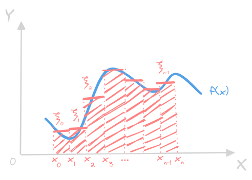
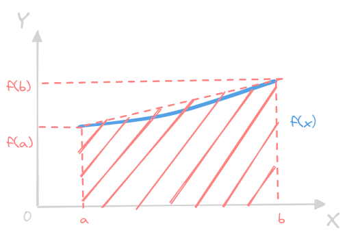
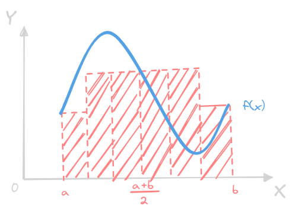
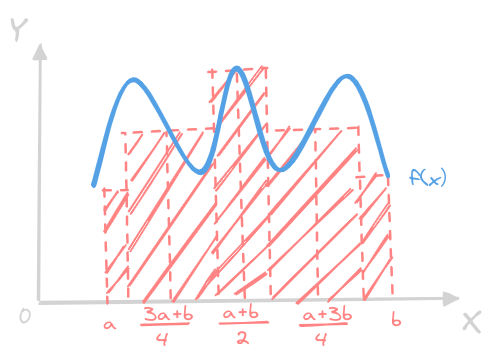
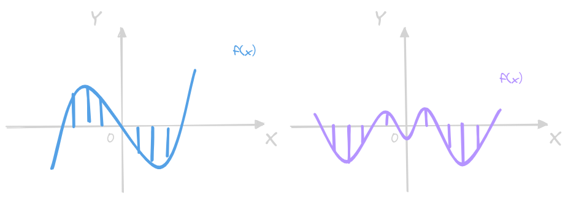
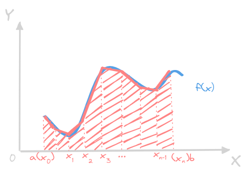
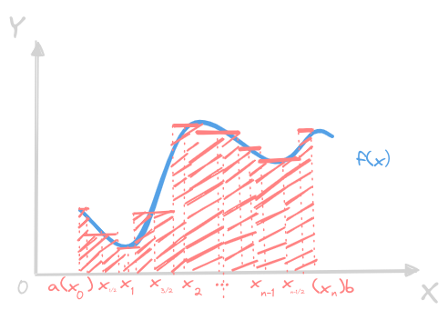

# 数值积分与数值微分

被积函数的原函数不易求得，使用**离散的数值方法**近似计算函数积分和微分

## 数值积分的基本概念

### 数值求积公式的代数精度
- 一元可积函数 $f(x)$ 在区间 $[a,b]$ 上的定积分的极限计算：  
    $$
    I = \int_{a}^{b}f(x)\mathrm dx = \lim_{h_{i}\rightarrow 0}\sum_{i=0}^{n-1}f(\xi_{i})h_{i}
    $$
    其中节点为 $a\leq x_{0}< x_{1}< \cdots< x_{n}\leq b$，并且有：
    $$
    h_{i} = x_{i+1}-x_{i},\qquad\xi_{i}\in[x_{i},x_{i+1}]
    $$
- 为充分利用各个节点，构造如下近似计算公式：
    $$
    I_{n} = \sum_{i=0}^{n}A_{i}f(x_{i})
    $$
    这要求**求积节点 $\{x_{i}\}$ 和求积系数 $\{A_{i}\}$ 与被积函数无关**，显然，$\{A_{i}\}$ 和求积区间 $[a,b]$ 与节点划分 $\{x_{i}\}$ 有紧密联系
- 若该求积公式对次数不超过 $m$ 次的多项式**都准确成立，取等**，但是对**某一个 $m+1$ 次的多项式不准确成立**，则这个求积公式**具有 $m$ 次代数精度**
- 某个充要条件：
    $$
    \begin{align*}
    &\int_{a}^{b}x^{k}\mathrm dx = \sum_{i=0}^{n}A_{i}x_{i}^{k},\qquad (k=0,1,\cdots,m)\\
    &\int_{a}^{b}x^{m+1}\mathrm dx \neq \sum_{i=0}^{n}A_{i}x_{i}^{m+1}\\
    \end{align*}
    $$
- 最佳选择：给定 $n+1$ 个节点，选取 $n+1$ 个求积系数使得该公式求积精度最高：
    $$
    \sum_{i=0}^{n}x_{i}^{k}A_{i} = \int_{a}^{b}x^{k}\mathrm dx,\qquad(k=0,1,\cdots,n)
    $$
    这个方程组有唯一解（系数矩阵是 Vandermonde 矩阵的转置），这个方程组有唯一解，因此
> 在 $[a.b]$ 上给定 $n+1$ 个求积节点 $\{x_{i}\}$ 则存在唯一的一组求积系数 $\{A_{i}\}$ 使得求积公式至少具有 $n$ 次代数精度

### 求积公式的收敛性和稳定性
- 近似计算公式的**截断误差**：
    $$
    E_{n}(f) = 
    \int_{a}^{b}f(x)\mathrm dx-I_{n} = 
    \int_{a}^{b}f(x)\mathrm dx-\sum_{i=0}^{n}A_{i}f(x_{i})
    $$
    当代数精度为 $m$ 的时候，显然有 $E_{n}(x^{k})=0$，其中 $k=0,1,\cdots,m$
- 如果**节点间距趋于零的时候截断误差也趋于零**，则求积公式**收敛**：
    $$
    \forall f(x)\left(
    \left(\max_{0\leq i\leq n-1}\{x_{i+1}-x_{i}\} \longrightarrow 0\right)
    \implies
    (E_{n}(f) \longrightarrow 0)
    \right)
    $$
- 考虑计算 $f(x_{i})$ 的时候的误差：
    $$
    e_{i} = f^{* }(x_{i}) - f(x_{i})
    $$
    综合成积分误差：
    $$
    e(I_{n}) = 
    \sum_{i=0}^{n}A_{i}f^{* }(x_{i}) - \sum_{i=0}^{n}A_{i}f(x_{i}) = 
    \sum_{i=0}^{n}A_{i}e_{i}
    $$
    设置上限 $\vert e_{i}\vert\leq\varepsilon$ ： 
    $$
    \vert e(I_{n})\vert \leq \varepsilon\sum_{i=0}^{n}A_{i}
    $$
- 如果求积系数 $A_{i} > 0$，对**至少具有零次代数精度**的求积公式：
    $$
    \sum_{i=0}^{n}A_{i} = b-a
    $$
    也即
    $$
    \vert e(I_{n})\vert\leq (b-a)\varepsilon
    $$
    此时积分误差上限不会超过函数值误差上限的 $b-a$ 倍，这**与求积节点数无关**，因此**求积系数大于零的时候，求积公式稳定**

## 插值型求积公式 
### 插值型求积公式
- 使用被积函数的**插值近似函数**的积分近似原积分
- 在积分区间 $[a,b]$ 上给定互异节点 $\{x_{i}\}$，则利用 Lagrange 插值公式：
    $$
    f(x) = \varphi(x) + R_{n}(x) = 
    \sum_{i-0}^{n}f_{i}(x_{i})l_{i}(x) + 
    \frac{f^{(n+1)}(\xi)}{(n+1)!}\prod_{i=0}^{n}(x-x_{i})
    $$
    这里 $\xi\in[a,b]$，积分得到
    $$
    \int_{a}^{b}f(x)\mathrm dx =
    \sum_{i-0}^{n}f_{i}(x_{i})\left(\int_{a}^{b}l_{i}(x)\mathrm dx\right) + 
    \int_{a}^{b}\frac{f^{(n+1)}(\xi)}{(n+1)!}\prod_{i=0}^{n}(x-x_{i})\mathrm dx
    $$
    其中截断误差为：
    $$
    E_{n}(f) = 
    \int_{a}^{b}\frac{f^{(n+1)}(\xi)}{(n+1)!}\prod_{i=0}^{n}(x-x_{i})\mathrm dx
    $$
    注意，这个截断误差只和 $f^{(n+1)}(\xi)$ 有关！从而有：
    $$
    \int_{a}^{b}f(x)\mathrm dx \approx
    \sum_{i-0}^{n}f_{i}(x_{i})\left(\int_{a}^{b}l_{i}(x)\mathrm dx\right) = 
    \sum_{i-0}^{n}\left(\int_{a}^{b}l_{i}(x)\mathrm dx\right)f_{i}(x_{i}) = 
    \sum_{i-0}^{n}A_{i}f_{i}(x_{i})
    $$
    其中：
    $$
    A_{i} = \int_{a}^{b}l_{i}(x)\mathrm dx,\qquad(i=0,1,\cdots,n)
    $$
    与 $f(x)$ 无关，故称为**数值求积公式**，又因为近似公式由插值函数的积分获得，故称为**插值型求积公式**
- 显然，有 $n+1$ 个求积节点的插值型求积公式**至少具有 $n$ 阶代数精度**
- 并且，具有 $n+1$ 个求积节点的**数值求积公式**是**插值型求积公式**的充要条件为其至少具有 $n$ 阶代数精度（回代插值基函数得到充分性）

### Newton-Cotes 求积公式
- 求积节点在区间 $[a,b]$ 等距分布：
    $$
    x_{i} = a+i\frac{b-a}{n},\qquad(i=0,1,\cdots,n)
    $$
    的时候，有 $x_{0}=a$ 和 $x_{n}=b$，这个时候称：
    $$
    \int_{a}^{b}f(x)\mathrm dx \approx
    \sum_{i-0}^{n}\left(\int_{a}^{b}l_{i}(x)\mathrm dx\right)f_{i}(x_{i}) = 
    \sum_{i-0}^{n}A_{i}f_{i}(x_{i}),\qquad(i=0,1,\cdots,n)
    $$
    为 **Newton-Cotes 求积公式**
- 可以设：
    $$
    x = a+th,\qquad h=\frac{b-a}{n}
    $$
    此时 $t\in[0,n]$，此时多项式项为：
    $$
    \begin{align*}
    & \prod_{i=0}^{n}(x-x_{i}) = \prod_{i=0}^{n}h^{n+1}(t-i) =  
    h^{n+1}t(t-1)\cdots(t-n) \\
        \\
    &  \frac
    {\displaystyle\prod_{j\neq i,j=0}^{n}(x-x_{j})}
    {\displaystyle\prod_{j\neq i,j=0}^{n}(x_{i}-x_{j})} =
    \frac
    {\displaystyle\prod_{j\neq i,j=0}^{n}(t-j)h^{n}}
    {(-1)^{i}i!(n-i)!h^{n}} = 
    (-1)^{i}
    \frac{t(t-1)\cdots(t-i+1)(t-i-1)\cdots(t-n)}{i!(n-i)!}\\
    \end{align*}
    $$
    代入插值型求积公式得到
    $$
    A_{i} = \int_{a}^{b}l_{i}(x)\mathrm dx = 
    (-1)^{i}\frac{h}{i!(n-i)!}\int_{0}^{n}t(t-1)\cdots(t-i-1)(t-i+1)\cdots(t-n)\mathrm dt
    $$
    也即：
    $$
    \begin{align*}
    A_{i} 
    = &h\frac{(-1)^{i}}{i!(n-i)!}\int_{0}^{n}t(t-1)\cdots(t-i-1)(t-i+1)\cdots(t-n)\mathrm dt \\
      \\
    = &(b-a)\frac{(-1)^{i}}{i!(n-i)!n}\int_{0}^{n}t(t-1)\cdots(t-i-1)(t-i+1)\cdots(t-n)\mathrm dt \\
    \end{align*}
    $$
    如果令：
    $$
    c_{i}^{(n)} = 
    \frac{(-1)^{i}}{i!(n-i)!n}\int_{0}^{n}t(t-1)\cdots(t-i-1)(t-i+1)\cdots(t-n)\mathrm dt \\
    $$
    可以得到：
    $$
    A_{i} = (b-a)c_{i}^{(n)}
    $$
    这里的 $c_{i}^{(n)}$ **和积分区间无关**，仅依赖**等距求积节点的个数**，称为一组 Cotes 系数，代入后得到 Newton-Cotes 求积公式：
    $$
    \int_{a}^{b}f(x)\mathrm dx = 
    (b-a)\sum_{i=0}^{n}c_{i}^{(n)}f_{i}\left(a+ih\right) + 
    \int_{0}^{n}\frac{f^{(n+1)}(\xi)}{(n+1)!}h^{n+2}t(t-1)\cdots(t-n)\mathrm dt\\
    $$
    代入 $\displaystyle h=\frac{b-a}{n}$ 得到：
    $$
    \int_{a}^{b}f(x)\mathrm dx = 
    (b-a)\sum_{i=0}^{n}c_{i}^{(n)}f_{i}\left(a+i\frac{b-a}{n}\right) + 
    \frac{1}{(n+1)!}\left(\frac{b-a}{n}\right)^{n+2}
    \int_{0}^{n}f^{(n+1)}(\xi)t(t-1)\cdots(t-n)\mathrm dt\\
    $$
    其中 $t = \displaystyle\frac{n}{b-a}\left(x-a\right)\in[0,n]$

### 几种常用的 Newton-Cotes 求积公式及代数精度
- 梯形求积公式（$n=1$）：
    $$
    T(x) = 
    \frac{b-a}{2}\left(f(a)+f(b)\right)
    $$
    一共 $2$ 个插值节点，具有 $1$ 次代数精度

     
- Simpson 求积公式（抛物型，$n=2$）：
    $$
    S(x) = 
    \frac{b-a}{6}\left(f(a)+4f\left(\frac{a+b}{2}\right)+f(b)\right)
    $$
    一共 $3$ 个插值节点，具有 $3$ 次代数精度

     
- Cotes 求积公式（抛物型，$n=4$）：
    $$
    C(x) = 
    \frac{b-a}{90}\left(
    7f\left(a\right)+32f\left(a+\frac{b-a}{4}\right)+12f\left(a+\frac{b-a}{2}\right) + 
    32f\left(a+\frac{3\left(b-a\right)}{4}\right) + 7f\left(b\right) 
    \right)
    $$
    一共 $5$ 个插值节点，具有 $5$ 次代数精度

> 反常积分中值定理：如果 $f(x)$ **连续且保号**，且 $g(x)$ 在 $[a,+\infty)$ 上**连续**，则
> $$
> \exists \eta\in[a,\infty)\left(\int_{a}^{+\infty}f(x)g(x)\mathrm dx = 
> g(\eta)\int_{a}^{+\infty}f(x)\mathrm dx\right)
> $$

- 一般地，节点数 $n+1$ 为奇数的时候，Newton-Cotes 公式的代数精度至少是 $n+1$，节点数 $n+1$ 是偶数的时候，代数精度至少是 $n$ （以下几个例子最后被积多项式在区间不变号，所以可以用**反常积分中值定理**）：
    $$
    E_{n}(f) = 
    \frac{f^{(n+1)}(\eta)}{(n+1)!}\left(\frac{b-a}{n}\right)^{n+2}
    \int_{0}^{n}t(t-1)\cdots(t-n)\mathrm dt\\
    $$
    - 如果 $n$ 是偶数，设为 $n=2m$，令 $f(x)=x^{2m+1}$，则
        $$
        f^{(2m+1)}(x) = (2m+1)!
        $$
        也即：
        $$
        E_{2m}(f) = 
        \frac{(2m+1)!}{(2m+1)!}\left(\frac{b-a}{2m}\right)^{2m+2}
        \int_{0}^{2m}t(t-1)\cdots(t-2m)\mathrm dt\\
        $$
        对积分式子化简得到：
        $$
        \int_{-m}^{m}(t+m)(t+m-1)\cdots(t+1)t(t-1)\cdots(t-m+1)(t-m)\mathrm dt = 0
        $$
        这里利用了**奇函数在对称区间上积分为零的特性**，因此代数精度至少为 $2m+1 = n+1$
    - 如果 $n$ 是奇数，设为 $n=2m+1$，令 $f(x)=x^{2m+2}$，则
        $$
        E_{2m+1}(f) = 
        \left(\frac{b-a}{2m}\right)^{2m+3}
        \int_{0}^{2m+1}t(t-1)(t-2m)\mathrm dt\\
        $$
        对积分式子化简得到：
        $$
        \int_{-(m+\frac{1}{2})}^{m+\frac{1}{2}}
        \left(t+m+\frac{1}{2}\right)\left(t+m-\frac{1}{2}\right)
        \cdots
        \left(t+\frac{1}{2}\right)\left(t-\frac{1}{2}\right)
        \cdots
        \left(t-m+\frac{1}{2}\right)\left(t-m-\frac{1}{2}\right)
        \mathrm dt
        $$
        这个偶函数的求积不一定为 $0$，但是因为是插值型求积公式，因此至少能保证 $2m+1=n$ 次代数精度

### 几种低阶求积公式的截断误差
- 对于 $n+1$ 个求积节点构成的 Newton-Cotes 公式，其截断误差为：
    $$
    E_{n}(f) = 
    \int_{a}^{b}\frac{f^{(n+1)}(\eta)}{(n+1)!}\prod_{i=0}^{n}(x-x_{i})\mathrm dx = 
    \left(\frac{b-a}{n}\right)^{n+2}
    \int_{0}^{n}\frac{f^{(n+1)}(\eta)}{(n+1)!}t(t-1)\cdots(t-n)\mathrm dt\\
    $$
    其中 $\eta\in(a,b)$
- 对于梯形公式，$n=1$，求积节点为 $2$，有 $1$ 次代数精度：
    $$
    E_{1}(f) = 
    \frac{f''(\eta)}{2!}\int_{a}^{b}(x-a)(x-b)\mathrm dx = -\frac{(b-a)^{3}}{12}f''(\xi)
    $$
- 对于 Simpson 公式，$n=2$，求积节点为 $3$，有 $3$ 次代数精度：
    $$
    E_{2}(f) = 
    \frac{f^{(3+1)}(\eta)}{(3+1)!}\int_{a}^{b}(x-a)\left(x-\frac{a+b}{2}\right)^{2}(x-b)\mathrm dx = 
    -\frac{(b-a)^{5}}{2880}f^{(4)}(\eta)
    $$
    注意，Simpson 公式等 $n$ 为偶数次的 Newton-Cotes 公式比奇次多一个代数精度，这在代数本质上说明了一件事，**奇函数在对称区间上积分为** $0$ !可以观察截断误差式子：
    $$
    r_{2m}(t) = (t+m)(t+m-1)\cdots(t+1)t(t-1)\cdots(t-m+1)(t-m)
    $$
    奇函数在对称区间 $[-m,m]$ 上积分后 $0$，因此具有 $3$ 次代数精度，计算截断误差可以使用**不超过三次 Hermite 插值多项式来平替**，
- 对于 Cotes 公式，$n=4$，求积节点为 $5$，有 $5$ 次代数精度：
    $$
    E_{4}(f) = -\frac{2(b-a)}{945}\left(\frac{b-a}{4}\right)^{6}f^{(6)}(\eta)
    $$
- 注意，当 $n$ 是偶数的时候，例如 $n=2$，则二次多项式 $f(x)=ax^{2}+bx+c$ 满足积分式子，三次多项式 $f(x)=ax^{3}+bx^{2}+cx+d$ 由于插值余项的积分
    $$
    E_{2}^{(1)}(f) = 
    \frac{f''(\eta)}{3!}\int_{a}^{b}(x-a)\left(x-\frac{a+b}{2}\right)(x-b)\mathrm dx = 0
    $$
    这印证了奇函数对称区间积分为 $0$，因此求插值余项的时候可以用加强约束条件的三次多项式作为积分项，如 Simpson 公式中构造了 Hermite 插值多项式：
    $$
    \begin{align*}
    &H_{3}(a) = f(a), \qquad H_{3}(b) = f(b)\\
        \\
    &H_{3}\left(\displaystyle\frac{a+b}{2}\right) = f\left(\displaystyle\frac{a+b}{2}\right)
    &H_{3}'\left(\displaystyle\frac{a+b}{2}\right) = f'\left(\displaystyle\frac{a+b}{2}\right)
    \end{align*}
    $$
    并且当 $f(x) = ax^{3}+bx^{2}+cx+d$ 的时候有：
    $$
    f^{(4)}(x) = 0
    $$
    因此三次多项式也满足，Simpson 插值型求积公式
- 注意，对于 Simpson 公式而言，中间节点导数一致这只是一种条件，实际上使用其他满足条件的三次多项式进行构造也可以得到类似的结果（注意，三次多项式有 $4$ 个待定系数！，其一定是和 $f(x)$ 高度绑定的，且要限定插值点）
    

## 复化求积算法
- 随着节点数的增加，等距节点插值函数**不保证收敛到被插值函数**，不保证收敛性
- 随着节点数的增加，Newton-Cotes 系数**有正有负**，不保证稳定
- Newton-Cotes 公式不保证收敛性和稳定性见[Newton-Cotes 公式的讨论](./补充/Newton-Cotes公式的性质.md)
- 提高计算精度的方法：将区间分成小区间，满足 $a=x_{0} < x_{1} < \cdots < x_{n}=b$，再用**低阶精度的 Newton-Cotes 公式求积**
- 得到复化的 Newton-Cotes 公式

### 复化求积算法
- 仅针对等分情形建立常用的复化求积，设
    $$
    x_{i}=a+ih,(i=0,1,\cdots,n),\qquad h = \frac{b-a}{n}
    $$
- 复化梯形公式：
    $$
    \int_{a}^{b}f(x)\mathrm dx = 
    \sum_{i=0}^{n-1}\int_{x_{i}}^{x_{i+1}}f(x)\mathrm dx = 
    \sum_{i=0}^{n-1}\frac{h}{2}[f(x_{i})+f(x_{i+1})] - \frac{h^{3}}{12}\sum_{i=0}^{n-1}f''(\eta_{i})
    $$
    整理得到：
    $$
    \int_{a}^{b}f(x)\mathrm dx = 
    \frac{h}{2}\left[f(a)+2\sum_{i=1}^{n-1}f(x_{i})+f(b)\right] - 
    \frac{b-a}{12}h^{2}
    \left[\frac{1}{n}\sum_{i=0}^{n-1}f''(\eta_{i})\right]
    $$
    复化梯形公式为：
    $$
    T(x) = \frac{b-a}{2n}\left[f(a)+2\sum_{i=1}^{n-1}f(x_{i})+f(b)\right]
    $$
    如果 $f''(x)$ 在 $[a.b]$ 上连续，利用介值定理可以得到截断误差
    $$
    \exists \eta\in(a,b)\left(
    E_{T}(f) = 
    \frac{b-a}{12}h^{2}
    \left[\frac{1}{n}\sum_{i=0}^{n-1}f''(\eta_{i})\right] = 
    \frac{b-a}{12}h^{2}f''(\eta)
    \right)
    $$
    截断误差和 $O(h^{2})$ **同阶**

- 复化 Simpson 公式（设 $x_{i+\frac{1}{2}} = \displaystyle x_{i}+\frac{h}{2}$）：
    $$
    \int_{a}^{b}f(x)\mathrm dx = 
    \sum_{i=0}^{n-1}\int_{x_{i}}^{x_{i+1}}f(x)\mathrm dx = 
    \sum_{i=0}^{n-1}\frac{h}{6}[f(x_{i})+4f(x_{i+\frac{1}{2}})+f(x_{i+1})] - 
    \frac{h^{5}}{2880}\sum_{i=0}^{n-1}f^{(4)}(\eta_{i})
    $$
    同样，整理得到：
    $$
    \int_{a}^{b}f(x)\mathrm dx = 
    \frac{h}{6}
    \left[f(a)+4\sum_{i=0}^{n-1}f(x_{i+\frac{1}{2}})+2\sum_{i=1}^{n-1}f(x_{i})+f(x_{b})\right] -
    \frac{b-a}{2880}h^{4}\sum_{i=0}^{n-1}\left[\frac{1}{n}f^{(4)}(\eta_{i})\right]
    $$
    复化的 Simpson 公式为：
    $$
    S(x) = \frac{b-a}{6n}
    \left[f(a)+4\sum_{i=0}^{n-1}f(x_{i+\frac{1}{2}})+2\sum_{i=1}^{n-1}f(x_{i})+f(x_{b})\right]
    $$
    如果 $f^{(4)}(x)$ 在 $[a.b]$ 上连续，利用介值定理可以得到截断误差：
    $$
    \exists \eta\in(a,b)\left(
    E_{S}(f) = 
    \frac{b-a}{2880}h^{4}f^{(4)}(\eta)
    \right)
    $$
    截断误差和 $O(h^{4})$ **同阶**

- 类似地，还可以建立复化的 Cotes 求积公式地截断误差：
    $$
    \exists \eta\in(a,b)\left(
    E_{C}(f) = 
    \frac{2(b-a)}{945}\left(\frac{h}{4}\right)^{6}f^{(6)}(\eta)
    \right)
    $$

### 误差的后验近似估计
- 采用复化求积公式得到满足精度要求地积分近似值，需要对被积函数的高阶导数做估计
- 估算高阶导数绝对值上界得到的节点数可能偏大，增加不必要计算量
- 考虑误差后验近似估计法
- 将区间 $[a,b]$ 进行 $n$ 等分，对每个子区间用梯形、Simpson、Cotes 公式求解得到 $T_{n}(f)$、$S_{n}(f)$、$C_{n}(f)$，$2n$ 等分就把下标改成 $2n$
- 利用复化梯形公式的截断误差：
    $$
    \begin{align*}
    E_{T_{n}}(f) = 
    \displaystyle\frac{b-a}{12}\left(\frac{b-a}{n}\right)^{2}f''(\eta_{n})\\
        \\
    E_{T_{2n}}(f) = 
    \displaystyle\frac{b-a}{12}\left(\frac{b-a}{2n}\right)^{2}f''(\eta_{2n})\\
    \end{align*}
    $$
    当 $f''(x)$ 在 $[a,b]$ **变化不大**的时候，有：
    $$
    \frac{E_{T_{n}}(f)}{E_{T_{2n}}(f)} = 
    \frac{I(f) - T_{n}(f)}{I(f) - T_{2n}(f)} \approx 4
    \qquad\implies\qquad
    I(f) \approx T_{2n}(f) +\frac{1}{2^{2}-1}[T_{2n}(f)-T_{n}(f)]
    $$
    可以得到一个判断标准：
    $$
    \vert T_{2n}(f)-T_{n}(f)\vert \leq \varepsilon
    $$
    基于 $T_{n}(f)$ 可以给出 $T_{2n}(f)$ 的计算公式：
    $$
    T_{2n}(x) = 
    \frac{b-a}{4n}\left[f(a)+2\sum_{i=1}^{2n-1}f(x_{i})+f(b)\right] = 
    \frac{b-a}{4n}\left[f(a)+2\sum_{i=1}^{n-1}f(x_{2i})+2\sum_{i=1}^{n}f(x_{2i-1})+f(b)\right]
    $$
    整理得到**步长折半的复化梯形求积公式**：
    $$
    T_{2n}(x) = 
    \frac{b-a}{4n}\left[f(a)+2\sum_{i=1}^{n-1}f(x_{2i})+f(b)\right]+
    \frac{2(b-a)}{4n}\sum_{i=1}^{n}f(x_{2i-1}) =
    \frac{1}{2}T_{n}(f) + \frac{b-a}{2n}\sum_{i=1}^{n}f(x_{2i-1})
    $$
- 类似地，假设 $f^{(4)}(x)$ 在区间 $[a,b]$ 上变化不大，则对复化 Simpson 公式有：
    $$
    I(f) \approx S_{2n}(f) + \frac{1}{2^{4}-1}[S_{2n}(f)-S_{n}(f)]
    $$
- 类似地，假设 $f^{(6)}(x)$ 在区间 $[a,b]$ 上变化不大，则复化 Simpson 公式有：
    $$
    I(f) \approx C_{2n}(f) + \frac{1}{2^{6}-1}[C_{2n}(f)-C_{n}(f)]
    $$

## Romberg 求积算法
### Romberg 求积算法
- 上述提到了**步长折半的复化梯形求积公式**有近似误差：
    $$
    E_{T_{2n}}(f) = I(f)-T_{2n}(f)\approx \frac{1}{2^{2}}(T_{2n}(f)-T_{n}(f))
    $$
    用误差对近似值校正（前提是二阶导数变化不大！），直接得到：
    $$
    I(f) \approx T_{2n}(f) +\frac{1}{2^{2}-1}[T_{2n}(f)-T_{n}(f)] = S_{n}(x)
    $$
    注意，**对步长折半的复化梯形公式进行误差校正可以得到复化 Simpson 公式**，此时误差阶将从 $O(h^{2})$ 提高到 $O(h^{4})$（废话，节点数都不一样）
- 同样地，对 Simpson 公式 和 Cotes 公式有：
    $$
    I(f) \approx S_{2n}(f) + \frac{1}{2^{4}-1}[S_{2n}(f)-S_{n}(f)] = C_{n}(f)
    $$
    误差阶从 $O(h^{4})$ 提高到了 $O(h^{6})$
- 对**步长折半的复化 Cotes 公式进行误差校正便得到 Romberg 公式**：
    $$
    I(f) \approx C_{2n}(f) + \frac{1}{2^{6}-1}[C_{2n}(f)-C_{n}(f)] = R_{n}(f)
    $$
    其误差阶为 $O(h^{6})$
- Romberg 求积算法的计算顺序：
    - 先求 $T_{1}$ 
    - 计算 $T_{2}$，根据 $T_{1}$ 和 $T_{2}$ 计算 $S_{1}$
    - 计算 $T_{4}$，根据 $T_{2}$ 和 $T_{4}$ 计算 $S_{2}$，根据 $S_{1}$ 和 $S_{2}$ 计算 $C_{1}$
    - 计算 $T_{8}$，根据 $T_{4}$ 和 $T_{8}$ 计算 $S_{4}$，根据 $S_{2}$ 和 $S_{4}$ 计算 $C_{2}$，根据 $C_{1}$ 和 $C_{2}$ 计算 $R_{1}$
    - 以此类推，直到 $R_{2n}-R_{n}\leq\varepsilon$ 的时候，终止迭代，所以这个误差估计是**后验误差估计**
- 注意，上节计算要求的各阶导数变化不大，所以是约等于，但是这里直接给出了一个误差校正的**恒等式**，因此，各阶导数对算法的影响就体现在复化算法的整体误差上。这是一个非常有意思的事情

### 外推技巧
- 注意，前面插值型求积公式讲到：
    $$
    \int_{a}^{b}f(x)\mathrm dx \approx
    \sum_{i-0}^{n}\left(\int_{a}^{b}l_{i}(x)\mathrm dx\right)f_{i}(x_{i}) = 
    \sum_{i-0}^{n}A_{i}f_{i}(x_{i}),\qquad(i=0,1,\cdots,n)
    $$
    中的**求积节点 $\{x_{i}\}$ 和求积系数 $\{A_{i}\}$ 与被积函数无关**，并且，$\{A_{i}\}$ 和求积区间 $[a,b]$ 与节点划分 $\{x_{i}\}$ 有紧密联系，在 Newton-Cotes 这种基于等距节点划分的插值型求积公式中我们又可以看到：
    $$
    A_{i} = (b-a)c_{i}^{(n)} = 
    (b-a)\frac{(-1)^{i}}{i!(n-i)!n}\int_{0}^{n}t(t-1)\cdots(t-i-1)(t-i+1)\cdots(t-n)\mathrm dt
    $$
    中的 Cotes 系数 $c_{i}^{(n)}$ 和求积节点个数 $n$ 有关，进而和区间步长 $h = \displaystyle\frac{b-a}{n}$ 有关，进而，几种复化的求积公式也就都是 $h$ 的函数，这几个函数都满足：
    $$
    \lim_{h\rightarrow0}F(h) = I(f)
    $$
- 利用泰勒展开：
    $$
    F(h) = I(f) + F'(0)h + \frac{F''(0)}{2!}h^2 + \cdots
    $$
    这里的系数都和步长无关，事实上，当 $F(h) = T_{n}(h)$ 的时候，也即是梯形公式的时候，**奇次项为零**！如果**被积函数 $f$ 无穷次可微**，则有：
    $$
    T_{n}(f) = I(f) + a_{1}h^{2} + a_{2}h^{4} + \cdots a_{k}h^{2k} + \cdots
    $$
- 为使得这个定理更加通用，设 $Q$ 和步长 $h$ 无关，$Q^* (h)$ 依赖于步长，渐进展开式为：
    $$
    Q^* (h) = Q + a_{1}h^{b_{1}} + a_{2}h^{b_{2}} + \cdots + a_{k}h^{b_{k}} + \cdots
    $$
    其中系数 $a_{1}$ 和步长 $h$ 无关，幂次满足：$0 < b_{1} < b_{2} < \cdots $，此时误差的量级为 $O(h^{b_{1}})$（幂次最小的量占主导），然后步长折半得到：
    $$
    Q^* \left(\frac{h}{2}\right) = 
    Q + a_{1}\left(\frac{h}{2}\right)^{b_{1}} + 
    a_{2}\left(\frac{h}{2}\right)^{b_{2}} + \cdots + 
    a_{k}\left(\frac{h}{2}\right)^{b_{k}} + \cdots
    $$
    整理得到：
    $$
    Q_{1}^* = \frac{Q^* (h) - 2^{b_{1}}Q^* \left(\displaystyle\frac{h}{2}\right)}{1-2^{b_{1}}} =
    Q + \hat a_{2}h^{b_{2}} + \hat a_{3}h^{b_{3}} + \cdots + \hat a_{k}h^{b_{k}} + \cdots
    $$
    这里的系数为：
    $$
    \hat a_{k} = a_{k}\frac{1-2^{b_{1}-b_{k}}}{1-2^{b_{1}}},\qquad(k=2,3,\cdots)
    $$
    这样，新的近似公式 $Q_{1}^* $ 就具有了更高阶的代数精度，可以表示为 $Q^* (h)$ 和 $Q^* \left(\displaystyle\frac{h}{2}\right)$ 的**线性组合**，类似地，可以对 $Q_{1}^* $ 做进一步的外推，得到更高阶近似，这正式上述梯形公式、Simpson 公式和 Cotes 公式复化的关系
- 对梯形公式使用外推技巧：
    $$
    S_{n}(f) = 
    \frac{T(h)-2^2T\left(\frac{h}{2}\right)}{1-2^2} = 
    \frac{T_{n}(f)-2^2T_{2n}\left(f\right)}{1-2^2} = 
    T_{2n}(f) + \frac{1}{3}[T_{2n}(f)-T_{n}(f)]
    $$
- 类似的复化 Cotes 公式也可以由 Simpson 公式外推得到，Romberg 公式也可以得到
## Gauss 型求积公式
### Gauss 型求积公式的一般理论
- 给定 $n+1$ 个求积节点，选取求积系数至少可以达到 $n$ 次代数精度，但如果**求积节点和求积系数**一共 $2n+2$ 个待定参数都进行优化选取，那含 $n+1$ 个求积节点的求积公式有望达到 $2n+1$ 次代数精度
- 下面考虑一个一般的带权求积：
    $$
    \int_{a}^{b}f(x)\rho(x)\mathrm dx \approx \sum_{i=0}^{n}A_{i}f(x_{i})
    $$
    无非就是变换一下 Lagrange 插值公式：
    $$
    f(x)\rho(x) = \varphi(x)\rho(x) + R_{n}(x)\rho(x) = 
    \sum_{i-0}^{n}f_{i}(x_{i})l_{i}(x)\rho(x) + 
    \frac{f^{(n+1)}(\xi)}{(n+1)!}\prod_{i=0}^{n}(x-x_{i})\rho(x)
    $$
    积分：
    $$
    \int_{a}^{b}f(x)\rho(x)\mathrm dx =
    \sum_{i=0}^{n}
    \left(\int_{a}^{b}\frac
    {\displaystyle\prod_{j\neq i,j=0}^{n}(x-x_{j})}
    {\displaystyle\prod_{j\neq i,j=0}^{n}(x_{i}-x_{j})}\rho(x)\mathrm dx
    \right)f(x_{i}) + 
    \int_{a}^{b}\frac{f^{(n+1)}(\xi)}{(n+1)!}\prod_{i=0}^{n}(x-x_{i})\rho(x)\mathrm dx
    $$
    也即：
    $$
    \int_{a}^{b}f(x)\rho(x)\mathrm dx = 
    \sum_{i=0}^{n}
    \left(
    \int_{a}^{b}l_{i}(x)\rho(x)\mathrm dx
    \right)f(x_{i}) + 
    \int_{a}^{b}\frac{f^{(n+1)}(\xi)}{(n+1)!}\prod_{i=0}^{n}(x-x_{i})\rho(x)\mathrm dx
    $$
    取求积系数：
    $$
    A_{i} = 
    \int_{a}^{b}l_{i}(x)\rho(x)\mathrm dx - 
    \int_{a}^{b}\frac
    {\displaystyle\prod_{j\neq i,j=0}^{n}(x-x_{j})}
    {\displaystyle\prod_{j\neq i,j=0}^{n}(x_{i}-x_{j})}\rho(x)\mathrm dx
    ,\qquad(i=0,1,\cdots,n)
    $$

     
    

### 几种常见的 Gauss 型求积公式

## 数值微分
### 插值型求导公式

### Taylor 级数展开法
