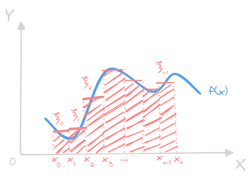
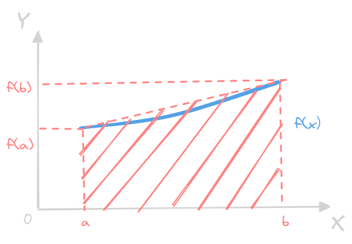
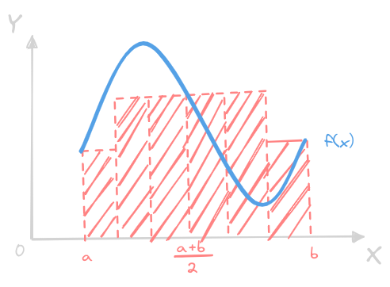
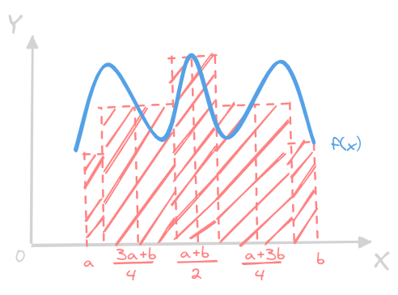
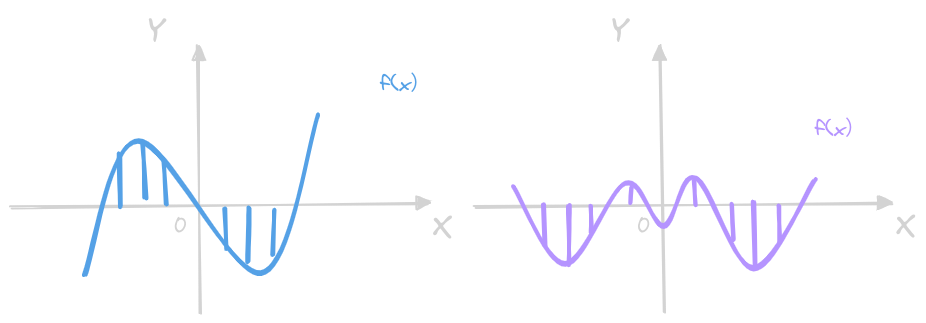

# 数值积分与数值微分

被积函数的原函数不易求得，使用**离散的数值方法**近似计算函数积分和微分

## 数值积分的基本概念

### 数值求积公式的代数精度
- 一元可积函数 $f(x)$ 在区间 $[a,b]$ 上的定积分的极限计算：  
    $$
    I = \int_{a}^{b}f(x)\mathrm dx = \lim_{h_{i}\rightarrow 0}\sum_{i=0}^{n-1}f(\xi_{i})h_{i}
    $$
    其中节点为 $a\leq x_{0}\leq x_{1}\leq\cdots\leq x_{n}\leq b$，并且有：
    $$
    h_{i} = x_{i+1}-x_{i},\qquad\xi_{i}\in[x_{i},x_{i+1}]
    $$
- 为充分利用各个节点，构造如下近似计算公式：
    $$
    I_{n} = \sum_{i=0}^{n}A_{i}f(x_{i})
    $$
    这要求**求积节点 $\{x_{i}\}$ 和求积系数 $\{A_{i}\}$ 与被积函数无关**，显然，$\{A_{i}\}$ 和求积区间 $[a,b]$ 与节点划分 $\{x_{i}\}$ 有紧密联系
- 若该求积公式对次数不超过 $m$ 次的多项式**都准确成立，取等**，但是对**某一个 $m+1$ 次的多项式不准确成立**，则这个求积公式**具有 $m$ 次代数精度**
- 某个充要条件：
    $$
    \begin{align*}
    &\int_{a}^{b}x^{k}\mathrm dx = \sum_{i=0}^{n}A_{i}x_{i}^{k},\qquad (k=0,1,\cdots,m)\\
    &\int_{a}^{b}x^{m+1}\mathrm dx \neq \sum_{i=0}^{n}A_{i}x_{i}^{m+1}\\
    \end{align*}
    $$
- 最佳选择：给定 $n+1$ 个节点，选取 $n+1$ 个求积系数使得该公式求积精度最高：
    $$
    \sum_{i=0}^{n}x_{i}^{k}A_{i} = \int_{a}^{b}x^{k}\mathrm dx,\qquad(k=0,1,\cdots,n)
    $$
    这个方程组有唯一解（系数矩阵是 Vandermonde 矩阵的转置），这个方程组有唯一解，因此
> 在 $[a.b]$ 上给定 $n+1$ 个求积节点 $\{x_{i}\}$ 则存在唯一的一组求积系数 $\{A_{i}\}$ 使得求积公式至少具有 $n$ 次代数精度

### 求积公式的收敛性和稳定性
- 近似计算公式的**截断误差**：
    $$
    E_{n}(f) = 
    \int_{a}^{b}f(x)\mathrm dx-I_{n} = 
    \int_{a}^{b}f(x)\mathrm dx-\sum_{i=0}^{n}A_{i}f(x_{i})
    $$
    当代数精度为 $m$ 的时候，显然有 $E_{n}(x^{k})=0$，其中 $k=0,1,\cdots,m$
- 如果**节点间距趋于零的时候截断误差也趋于零**，则求积公式**收敛**：
    $$
    \forall f(x)\left(
    \left(\max_{0\leq i\leq n-1}\{x_{i+1}-x_{i}\} \longrightarrow 0\right)
    \implies
    (E_{n}(f) \longrightarrow 0)
    \right)
    $$
- 考虑计算 $f(x_{i})$ 的时候的误差：
    $$
    e_{i} = f^{* }(x_{i}) - f(x_{i})
    $$
    综合成积分误差：
    $$
    e(I_{n}) = 
    \sum_{i=0}^{n}A_{i}f^{* }(x_{i}) - \sum_{i=0}^{n}A_{i}f(x_{i}) = 
    \sum_{i=0}^{n}A_{i}e_{i}
    $$
    设置上限 $\vert e_{i}\vert\leq\varepsilon$ ： 
    $$
    \vert e(I_{n})\vert \leq \varepsilon\sum_{i=0}^{n}A_{i}
    $$
- 如果求积系数 $A_{i} > 0$，对**至少具有零次代数精度**的求积公式：
    $$
    \sum_{i=0}^{n}A_{i} = b-a
    $$
    也即
    $$
    \vert e(I_{n})\vert\leq (b-a)\varepsilon
    $$
    此时积分误差上限不会超过函数值误差上限的 $b-a$ 倍，这**与求积节点数无关**，因此**求积系数大于零的时候，求积公式稳定**

## 插值型求积公式 
### 插值型求积公式
- 使用被积函数的**插值近似函数**的积分近似原积分
- 在积分区间 $[a,b]$ 上给定互异节点 $\{x_{i}\}$，则利用 Lagrange 插值公式：
    $$
    f(x) = \varphi(x) + R_{n}(x) = 
    \sum_{i-0}^{n}f_{i}(x_{i})l_{i}(x) + 
    \frac{f^{(n+1)}(\xi)}{(n+1)!}\prod_{i=0}^{n}(x-x_{i})
    $$
    这里 $\xi\in[a,b]$，积分得到
    $$
    \int_{a}^{b}f(x)\mathrm dx =
    \sum_{i-0}^{n}f_{i}(x_{i})\left(\int_{a}^{b}l_{i}(x)\mathrm dx\right) + 
    \int_{a}^{b}\frac{f^{(n+1)}(\xi)}{(n+1)!}\prod_{i=0}^{n}(x-x_{i})\mathrm dx
    $$
    其中截断误差为：
    $$
    E_{n}(f) = 
    \int_{a}^{b}\frac{f^{(n+1)}(\xi)}{(n+1)!}\prod_{i=0}^{n}(x-x_{i})\mathrm dx
    $$
    从而有：
    $$
    \int_{a}^{b}f(x)\mathrm dx \approx
    \sum_{i-0}^{n}f_{i}(x_{i})\left(\int_{a}^{b}l_{i}(x)\mathrm dx\right) = 
    \sum_{i-0}^{n}\left(\int_{a}^{b}l_{i}(x)\mathrm dx\right)f_{i}(x_{i}) = 
    \sum_{i-0}^{n}A_{i}f_{i}(x_{i})
    $$
    其中：
    $$
    A_{i} = \int_{a}^{b}l_{i}(x)\mathrm dx,\qquad(i=0,1,\cdots,n)
    $$
    与 $f(x)$ 无关，故称为**数值求积公式**，又因为近似公式由插值函数的积分获得，故称为**插值型求积公式**
- 显然，有 $n+1$ 个求积节点的插值型求积公式**至少具有 $n$ 阶代数精度**
- 并且，具有 $n+1$ 个求积节点的**数值求积公式**是**插值型求积公式**的充要条件为其至少具有 $n$ 阶代数精度（回代插值基函数得到充分性）

### Newton-Cotes 求积公式
- 求积节点在区间 $[a,b]$ 等距分布：
    $$
    x_{i} = a+i\frac{b-a}{n},\qquad(i=0,1,\cdots,n)
    $$
    的时候，有 $x_{0}=a$ 和 $x_{n}=b$，这个时候称：
    $$
    \int_{a}^{b}f(x)\mathrm dx \approx
    \sum_{i-0}^{n}\left(\int_{a}^{b}l_{i}(x)\mathrm dx\right)f_{i}(x_{i}) = 
    \sum_{i-0}^{n}A_{i}f_{i}(x_{i}),\qquad(i=0,1,\cdots,n)
    $$
    为 **Newton-Cotes 求积公式**
- 可以设：
    $$
    x = a+th,\qquad h=\frac{b-a}{n}
    $$
    此时 $t\in[0,n]$，此时多项式项为：
    $$
    \begin{align*}
    & \prod_{i=0}^{n}(x-x_{i}) = \prod_{i=0}^{n}h^{n+1}(t-i) =  
    h^{n+1}t(t-1)\cdots(t-n) \\
        \\
    &  \frac
    {\displaystyle\prod_{j\neq i,j=0}^{n}(x-x_{j})}
    {\displaystyle\prod_{j\neq i,j=0}^{n}(x_{i}-x_{j})} =
    \frac
    {\displaystyle\prod_{j\neq i,j=0}^{n}(t-j)h^{n}}
    {(-1)^{i}i!(n-i)!h^{n}} = 
    (-1)^{i}
    \frac{t(t-1)\cdots(t-i+1)(t-i-1)\cdots(t-n)}{i!(n-i)!}\\
    \end{align*}
    $$
    代入插值型求积公式得到
    $$
    A_{i} = \int_{a}^{b}l_{i}(x)\mathrm dx = 
    (-1)^{i}\frac{h}{i!(n-i)!}\int_{0}^{n}t(t-1)\cdots(t-i-1)(t-i+1)\cdots(t-n)\mathrm dt
    $$
    也即：
    $$
    \begin{align*}
    A_{i} 
    = &h\frac{(-1)^{i}}{i!(n-i)!}\int_{0}^{n}t(t-1)\cdots(t-i-1)(t-i+1)\cdots(t-n)\mathrm dt \\
      \\
    = &(b-a)\frac{(-1)^{i}}{i!(n-i)!n}\int_{0}^{n}t(t-1)\cdots(t-i-1)(t-i+1)\cdots(t-n)\mathrm dt \\
    \end{align*}
    $$
    如果令：
    $$
    c_{i}^{(n)} = 
    \frac{(-1)^{i}}{i!(n-i)!n}\int_{0}^{n}t(t-1)\cdots(t-i-1)(t-i+1)\cdots(t-n)\mathrm dt \\
    $$
    可以得到：
    $$
    A_{i} = (b-a)c_{i}^{(n)}
    $$
    这里的 $c_{i}^{(n)}$ **和积分区间无关**，仅依赖**等距求积节点的个数**，称为一组 Cotes 系数，代入后得到 Newton-Cotes 求积公式：
    $$
    \int_{a}^{b}f(x)\mathrm dx = 
    (b-a)\sum_{i=0}^{n}c_{i}^{(n)}f_{i}\left(a+ih\right) + 
    \int_{0}^{n}\frac{f^{(n+1)}(\xi)}{(n+1)!}h^{n+2}t(t-1)\cdots(t-n)\mathrm dt\\
    $$
    代入 $\displaystyle h=\frac{b-a}{n}$ 得到：
    $$
    \int_{a}^{b}f(x)\mathrm dx = 
    (b-a)\sum_{i=0}^{n}c_{i}^{(n)}f_{i}\left(a+i\frac{b-a}{n}\right) + 
    \frac{1}{(n+1)!}\left(\frac{b-a}{n}\right)^{n+2}
    \int_{0}^{n}f^{(n+1)}(\xi)t(t-1)\cdots(t-n)\mathrm dt\\
    $$
    其中 $t = \displaystyle\frac{n}{b-a}\left(x-a\right)\in[0,n]$

### 几种常用的 Newton-Cotes 求积公式及代数精度
- 梯形求积公式（$n=1$）：
    $$
    T(x) = 
    \frac{b-a}{2}\left(f(a)+f(b)\right)
    $$
    一共 $2$ 个插值节点，具有 $1$ 次代数精度

     
- Simpson 求积公式（抛物型，$n=2$）：
    $$
    S(x) = 
    \frac{b-a}{6}\left(f(a)+4f\left(\frac{a+b}{2}\right)+f(b)\right)
    $$
    一共 $3$ 个插值节点，具有 $3$ 次代数精度

     
- Cotes 求积公式（抛物型，$n=4$）：
    $$
    C(x) = 
    \frac{b-a}{90}\left(
    7f\left(a\right)+32f\left(a+\frac{b-a}{4}\right)+12f\left(a+\frac{b-a}{2}\right) + 
    32f\left(a+\frac{3\left(b-a\right)}{4}\right) + 7f\left(b\right) 
    \right)
    $$
    一共 $5$ 个插值节点，具有 $5$ 次代数精度

> 反常积分中值定理：如果 $f(x)$ **连续且保号**，且 $g(x)$ 在 $[a,+\infty)$ 上**连续**，则
> $$
> \exists \eta\in[a,\infty)\left(\int_{a}^{+\infty}f(x)g(x)\mathrm dx = 
> g(\eta)\int_{a}^{+\infty}f(x)\mathrm dx\right)
> $$

- 一般地，节点数 $n+1$ 为奇数的时候，Newton-Cotes 公式的代数精度至少是 $n+1$，节点数 $n+1$ 是偶数的时候，代数精度至少是 $n$ （以下几个例子最后被积多项式在区间不变号，所以可以用**反常积分中值定理**）：
    $$
    E_{n}(f) = 
    \frac{f^{(n+1)}(\eta)}{(n+1)!}\left(\frac{b-a}{n}\right)^{n+2}
    \int_{0}^{n}t(t-1)\cdots(t-n)\mathrm dt\\
    $$
    - 如果 $n$ 是偶数，设为 $n=2m$，令 $f(x)=x^{2m+1}$，则
        $$
        f^{(2m+1)}(x) = (2m+1)!
        $$
        也即：
        $$
        E_{2m}(f) = 
        \frac{(2m+1)!}{(2m+1)!}\left(\frac{b-a}{2m}\right)^{2m+2}
        \int_{0}^{2m}t(t-1)\cdots(t-2m)\mathrm dt\\
        $$
        对积分式子化简得到：
        $$
        \int_{-m}^{m}(t+m)(t+m-1)\cdots(t+1)t(t-1)\cdots(t-m+1)(t-m)\mathrm dt = 0
        $$
        这里利用了**奇函数在对称区间上积分为零的特性**，因此代数精度至少为 $2m+1 = n+1$
    - 如果 $n$ 是奇数，设为 $n=2m+1$，令 $f(x)=x^{2m+2}$，则
        $$
        E_{2m+1}(f) = 
        \left(\frac{b-a}{2m}\right)^{2m+3}
        \int_{0}^{2m+1}t(t-1)(t-2m)\mathrm dt\\
        $$
        对积分式子化简得到：
        $$
        \int_{-(m+\frac{1}{2})}^{m+\frac{1}{2}}
        \left(t+m+\frac{1}{2}\right)\left(t+m-\frac{1}{2}\right)
        \cdots
        \left(t+\frac{1}{2}\right)\left(t-\frac{1}{2}\right)
        \cdots
        \left(t-m+\frac{1}{2}\right)\left(t-m-\frac{1}{2}\right)
        \mathrm dt
        $$
        这个偶函数的求积不一定为 $0$，但是因为是插值型求积公式，因此至少能保证 $2m+1=n$ 次代数精度

### 几种低阶求积公式的截断误差
- 对于 $n+1$ 个求积节点构成的 Newton-Cotes 公式，其截断误差为：
    $$
    E_{n}(f) = 
    \int_{a}^{b}\frac{f^{(n+1)}(\eta)}{(n+1)!}\prod_{i=0}^{n}(x-x_{i})\mathrm dx = 
    \left(\frac{b-a}{n}\right)^{n+2}
    \int_{0}^{n}\frac{f^{(n+1)}(\eta)}{(n+1)!}t(t-1)\cdots(t-n)\mathrm dt\\
    $$
    其中 $\eta\in(a,b)$
- 对于梯形公式，$n=1$，求积节点为 $2$，有 $1$ 次代数精度：
    $$
    E_{1}(f) = 
    \frac{f''(\eta)}{2!}\int_{a}^{b}(x-a)(x-b)\mathrm dx = -\frac{(b-a)^{3}}{12}f''(\xi)
    $$
- 对于 Simpson 公式，$n=2$，求积节点为 $3$，有 $3$ 次代数精度：
    $$
    E_{2}(f) = 
    \frac{f^{(3+1)}(\eta)}{(3+1)!}\int_{a}^{b}(x-a)\left(x-\frac{a+b}{2}\right)^{2}(x-b)\mathrm dx = 
    -\frac{(b-a)^{5}}{2880}f^{(4)}(\eta)
    $$
    注意，Simpson 公式等 $n$ 为偶数次的 Newton-Cotes 公式比奇次多一个代数精度，这在代数本质上说明了一件事：偶函数如果在原点函数值为 $0$，则不仅函数值为 $0$，而且**导函数**也为零！可以观察截断误差式子：
    $$
    r_{2m}(t) = (t+m)(t+m-1)\cdots(t+1)t(t-1)\cdots(t-m+1)(t-m)
    $$
    奇函数积分后变成**偶函数**，所以满足这种条件的 $3$ 次函数天然满足**一阶导数匹配**，所以计算截断误差可以使用**三次 Hermite 插值多项式来平替**，因此具有 $3$ 次代数精度
- 对于 Cotes 公式，$n=4$，求积节点为 $5$，有 $5$ 次代数精度：
    $$
    E_{4}(f) = -\frac{2(b-a)}{945}\left(\frac{b-a}{4}\right)^{6}f^{(6)}(\eta)
    $$

## 复化求积算法
### 复化求积算法

### 误差的后验近似估计

## Romberg 求积算法
### Romberg 求积算法

### 外推技巧

## Gauss 型求积公式
### Gauss 型求积公式的一般理论

### 几种常见的 Gauss 型求积公式

## 数值微分
### 插值型求导公式

### Taylor 级数展开法
