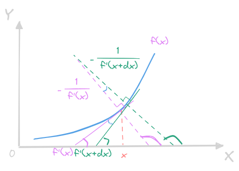
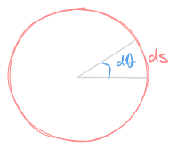

# 二阶可导函数的曲率
---
众所周知，导函数切线，对于一个**弧线**而言，是可以用**圆弧**去近似

## 曲率半径
曲率半径指的是一个曲线弧用圆弧去近似时，圆弧半径的大小，考虑一个一元函数 $f(x)$

其切线斜率为 $f'(x)$，则与切线**垂直**的方向，斜率满足：
$$\left(f'(x)\right)^{\perp}f'(x) = -1$$
也即
$$\left(f'(x)\right)^{\perp} = -\frac{1}{f'(x)}$$
利用半径和圆弧的关系：

利用微分形式来表达：
$$\rho = \frac{\mathrm ds}{\mathrm d\theta}$$
这里的 $\mathrm ds$ 就是**切线弧**的微元：
$$\mathrm ds = \sqrt{(\mathrm dx)^{2}+(\mathrm dy)^{2}} = \sqrt{1+(f'(x))^{2}}\mathrm dx$$
而角度可以利用**法线的反正切的微元**来计算：
$$\mathrm d\theta = \mathrm d \arctan\left(-\frac{1}{f'(x)}\right) = \mathrm d \arctan f'(x)$$
为求解简便，使用切线的反正切的微元来求解，也即：
$$
\mathrm d\theta 
= \mathrm d \arctan f'(x) 
= \frac{\mathrm d \arctan f'(x)}{\mathrm dx}\mathrm dx 
= \frac{f''(x)}{1+\left(f'(x)\right)^{2}}\mathrm dx 
$$
综合可得到：
$$
\rho =
\frac{\mathrm ds}{\mathrm d\theta} = 
\frac{\sqrt{1+(f'(x))^{2}}\mathrm dx}{\left(\displaystyle\frac{f''(x)}{1+\left(f'(x)\right)^{2}}\right)\mathrm dx} = 
\frac{1+(f'(x))^{\frac{3}{2}}}{f''(x)}
$$
当曲率半径越大的时候，曲线弧**越接近直线**，曲线的**弯曲程度越小**

## 曲率
为了用一个**单调递增**的函数形式来度量**曲线的弯曲程度**，这里使用曲线的**曲率**来度量，定义其为**曲率半径的倒数**
$$
\kappa = \frac{1}{\rho} = 
\frac{f''(x)}{1+(f'(x))^{\frac{3}{2}}}
$$
由此可以看到，只是一阶导数相等而不保证二阶导数相等，那曲线虽然具有光滑性，但是也比较一般，如果保证二阶导数相等，那么曲率也就相等，这个时候曲线就更为**光滑**了，更进一步，还有**曲率的变化率**等，不做拓展

## 参数方程的曲率和曲率半径
更一般的，如果用 $x(t),y(t)$ 来表达曲线，则弧段微元为：
$$
\mathrm ds = 
\sqrt{(\mathrm dx)^{2}+(\mathrm dy)^{2}} = 
\sqrt{(x'(t))^{2}+(y'(t))^{2}}\mathrm dt
$$
角度微元为：
$$
\mathrm d\theta 
= \mathrm d \arctan \frac{\mathrm dy}{\mathrm dx}
= \mathrm d \arctan \frac{y'(t)}{x'(t)}
= \frac
{\left(\displaystyle\frac{y''(t)x'(t)-y'(t)x''(t)}{(x'(t))^{2}}\right)}
{1+\left(\displaystyle\frac{y'(t)}{x'(t)}\right)^{2}}\mathrm dt
= 
\frac
{y''(t)x'(t)-y'(t)x''(t)}{(x'(t))^{2}+(y'(t))^{2}}\mathrm dt
$$
因此可以得到：
$$
\rho = 
\frac{\mathrm ds}{\mathrm d\theta} = 
\frac
{\sqrt{(x'(t))^{2}+(y'(t))^{2}}\mathrm dt}
{
\left(
\displaystyle\frac
{y''(t)x'(t)-y'(t)x''(t)}{(x'(t))^{2}+(y'(t))^{2}}\right)
\mathrm dt
}
=  
\frac
{\left((x'(t))^{2}+(y'(t))^{2}\right)^{\frac{3}{2}}}
{y''(t)x'(t)-y'(t)x''(t)}
$$
相应的，曲率为
$$
\kappa =
\frac
{y''(t)x'(t)-y'(t)x''(t)}
{\left((x'(t))^{2}+(y'(t))^{2}\right)^{\frac{3}{2}}}
$$

