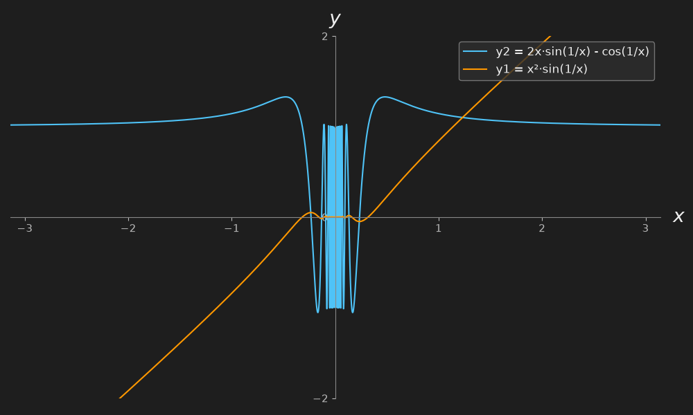

# 罗尔定理和函数插值法
---
## 1. 罗尔定理

设函数 $f(x)$ 满足：

1. 在闭区间 $[a,b]$ 上连续；
2. 在开区间 $(a,b)$ 内可导；
3. $f(a)=f(b)$。

则至少存在一点 $c\in(a,b)$，使得
$$
f'(c)=0.
$$

几何意义：曲线两端高度相同，中间至少有一点的切线水平。罗尔定理只要求原函数 $f$ 连续、可导，**不要求导函数 $f'$ 连续**。

---

## 2. 高阶罗尔定理

一种常见表述是：

若

1. $f$ 在闭区间 $[a_{0},a_{n+1}]$ 上有直到 $n$ 阶连续导数，即 $f\in C^{n}([a_{0},a_{n+1}])$；
2. $f^{(n+1)}$ 在开区间 $(a_{0},a_{n+1})$ 内存在；
3. 存在 $n+2$ 个点
$$
a_{0} < a_{1} < \cdots < a_{n+1},
$$
使得
$$
f(a_{0})=f(a_{1})=\cdots=f(a_{n+1}),
$$
则至少存在一点 $\xi\in(a_{0},a_{n+1})$，使得
$$
f^{(n+1)}(\xi)=0.
$$

### 条件为什么这样写

高阶罗尔定理是反复使用罗尔定理得到的。最后一步是对 $g=f^{(n)}$ 使用罗尔定理，因此需要：

- $f^{(n)}$ 在相应闭区间上连续；
- $f^{(n)}$ 在相应开区间内可导，即 $f^{(n+1)}$ 存在；
- 两端函数值相等。

所以标准条件写成：

$$
f^{(n)}\text{ 连续，且 }f^{(n+1)}\text{ 存在。}
$$

其中：

- **$f^{(n+1)}$ 存在已经保证开区间内 $f^{(n)}$ 可导**；
- **$f^{(n)}$ 连续负责满足罗尔定理的闭区间连续条件**；
- **不要求 $f^{(n+1)}$ 连续**；
- **不要求 $f^{(n+1)}$ 在端点存在**，因为结论点 $\xi$ 在开区间内；
- 若额外假设 $f^{(n+1)}$ 连续，那是更强的充分条件，但不是定理必需。

另外，若结论是 $f^{(n+1)}(\xi)=0$，则需要 $n+2$ 个等值点。若只有两个等值点，只能保证一阶导数为零，不能保证高阶导数为零。

---

## 3. 罗尔定理应用于“导函数有第二类间断点”的例子

注意：这里第二类间断点是**导函数 $f'$ 的间断点**，不是原函数 $f$ 的间断点。罗尔定理要求原函数 $f$ 在闭区间上连续，因此若原函数本身有第二类间断点，就不能直接用罗尔定理。

定义
$$
f(x)=
\begin{cases}
x^{2}\sin\dfrac{1}{x}, & x\ne 0,\\[6pt]
0, & x=0.
\end{cases}
$$

取区间
$$
\left[-\frac{1}{\pi},\frac{1}{\pi}\right].
$$

验证条件：

1. $f$ 在 $\left[-\frac{1}{\pi},\frac{1}{\pi}\right]$ 上连续；
2. $f$ 在 $\left(-\frac{1}{\pi},\frac{1}{\pi}\right)$ 内可导；
3. 端点值相等：
$$
f\left(-\frac{1}{\pi}\right)=0,\qquad
f\left(\frac{1}{\pi}\right)=0.
$$

因此罗尔定理保证存在
$$
c\in\left(-\frac{1}{\pi},\frac{1}{\pi}\right)
$$
使得
$$
f'(c)=0.
$$

事实上，
$$
f'(0)=\lim_{x\to 0}\frac{x^{2}\sin(1/x)-0}{x}
=\lim_{x\to 0}x\sin\frac{1}{x}=0.
$$
所以 $c=0$ 就是一个满足条件的点。

但当 $x\ne 0$ 时，
$$
f'(x)=2x\sin\frac{1}{x}-\cos\frac{1}{x}.
$$
当 $x\to 0$ 时，$2x\sin(1/x)\to 0$，而 $\cos(1/x)$ 振荡不趋于唯一值，因此 $f'(x)$ 在 $0$ 处不连续。这是一个**有界振荡型的第二类间断点**。

这个例子说明：

- 罗尔定理只要求 $f$ 连续、可导；
- 不要求 $f'$ 连续；
- 即使 $f'$ 有第二类间断点，只要 $f$ 本身满足罗尔定理条件，定理仍可使用。

---

## 4. 总结

- **罗尔定理**：$f$ 在 $[a,b]$ 连续，在 $(a,b)$ 可导，且 $f(a)=f(b)$，则存在 $c\in(a,b)$ 使 $f'(c)=0$。
- **高阶罗尔定理**：需要足够多的等值点；若结论为 $f^{(n+1)}(\xi)=0$，通常需要 $n+2$ 个等值点，并要求 $f^{(n)}$ 连续、$f^{(n+1)}$ 在开区间内存在。
- **不要求 $f^{(n+1)}$ 连续**，也不要求它在端点存在。
- 若原函数本身有第二类间断点，则不满足罗尔定理的连续性条件，不能直接应用；但原函数连续可导、导函数有第二类间断点的情形完全可以应用罗尔定理。
